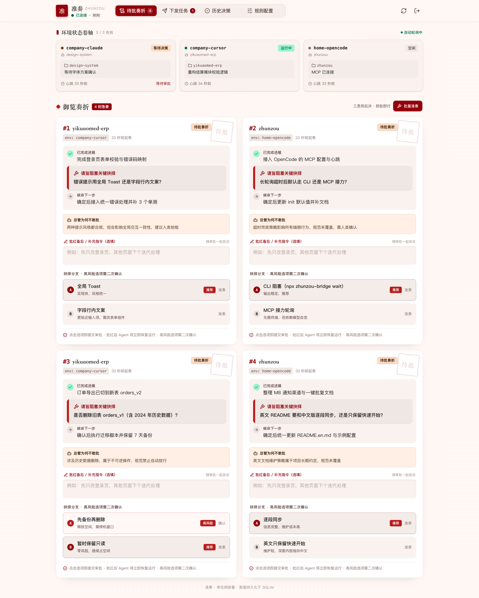
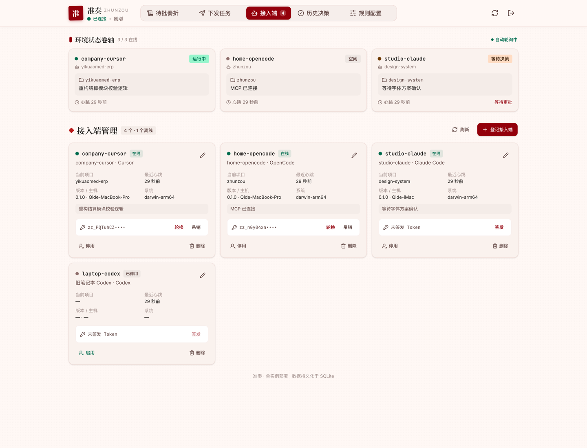
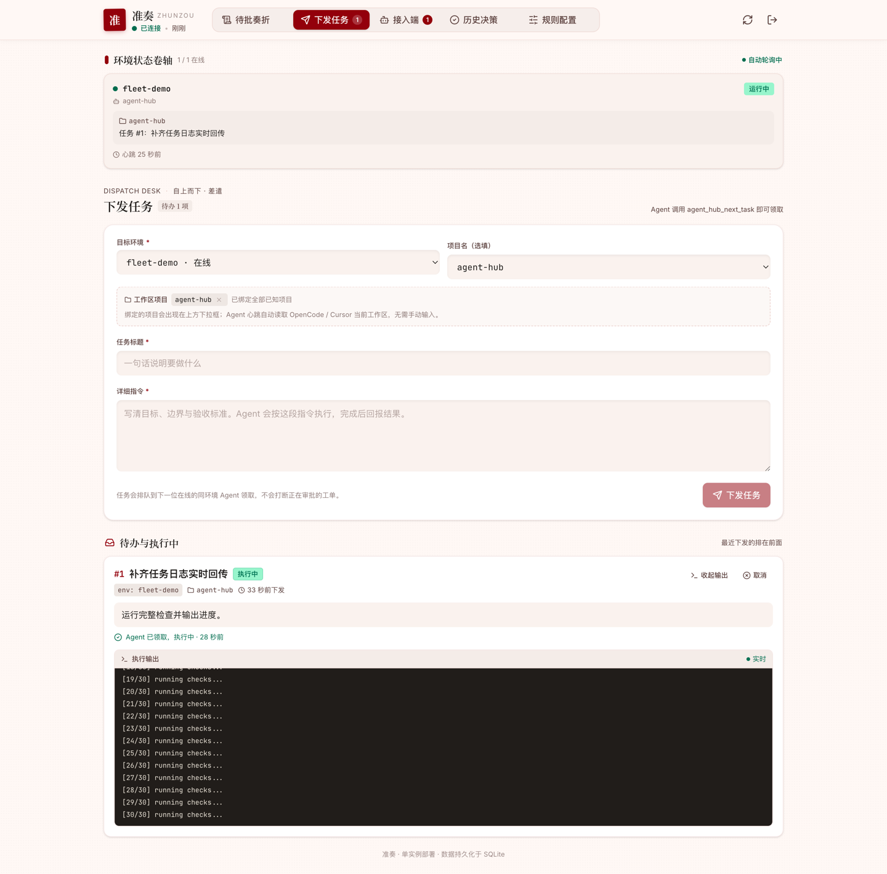
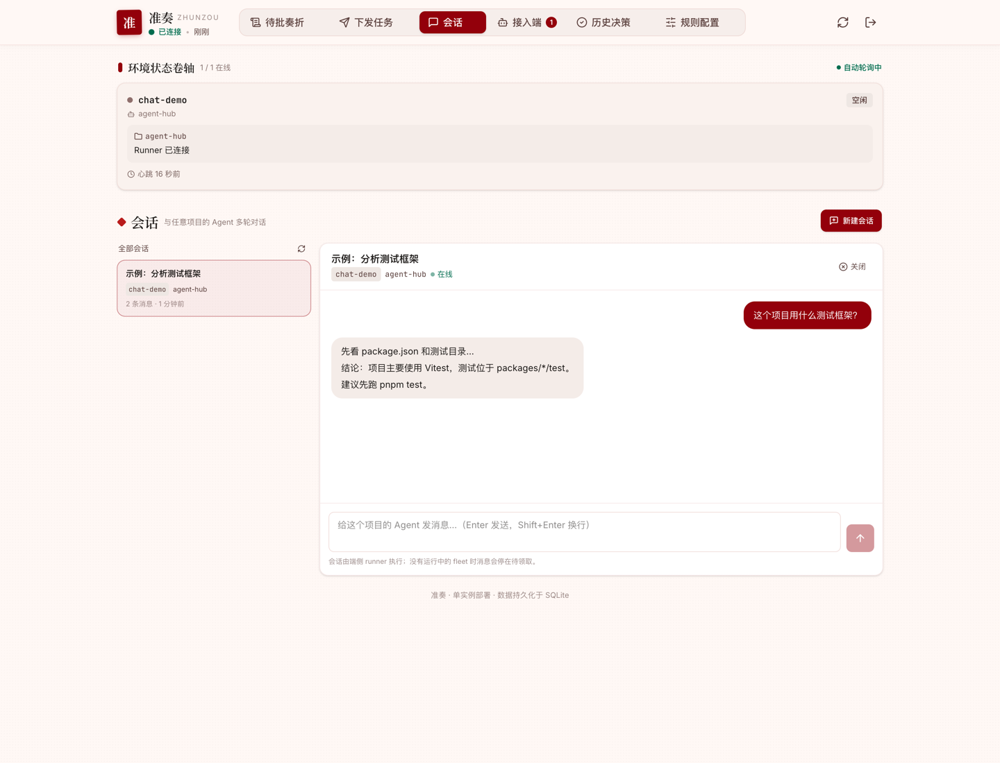

# Zhunzou (准奏)

**English** · [中文说明](./README.zh-CN.md)

> Agents submit a brief. The Meta-Agent drafts a ruling. You say “approved”.

**A cross-device, editor-agnostic decision hub for AI coding agents.**

<p align="center">
  <a href="https://github.com/Asterune/ZhunZou/actions/workflows/ci.yml"></a>
  <a href="./LICENSE"></a>
  <a href="./package.json">= 20" /></a>
</p>

<p align="center">
  
</p>

When Cursor, OpenCode, Claude Code, or any MCP-capable agent gets blocked on a decision that needs a human, it submits a compact “three-line brief + closed-form options” ticket to Zhunzou. A Meta-Agent resolves routine decisions automatically against your engineering rules. Everything else waits in a single dashboard, and the agent resumes the moment you click.

Self-hosted, single process, SQLite-backed, MIT licensed. No message queue, no native build step on the client.

---

## Contents

- [The problem](#the-problem)
- [What Zhunzou does](#what-zhunzou-does)
- [Why Zhunzou](#why-zhunzou)
- [Status](#status)
- [Features](#features)
- [Dashboard](#dashboard)
- [Architecture](#architecture)
- [Repository layout](#repository-layout)
- [Quick start](#quick-start)
- [Connect an agent](#connect-an-agent)
- [API](#api)
- [Configuration](#configuration)
- [Safety model](#safety-model)
- [Development](#development)
- [Deployment](#deployment)
- [Design notes](#design-notes)
- [Roadmap](#roadmap)
- [Documentation map](#documentation-map)
- [Contributing](#contributing)
- [License](#license)

---

## The problem

AI agents are fast until they need a human judgment call. In practice, that is where most of the promised speed disappears:

- **The agent stalls where you cannot see it.** It stops in a terminal or editor tab you are not watching, and the task waits for hours.
- **Or it guesses, and you review the damage later.** You discover the wrong assumption during code review, or in production.
- **The same question comes back.** A decision lives in one chat transcript, so the next agent (or the next week) asks it again.
- **Every tool has its own approval silo.** A Cursor window, a Claude Code session, and a CI job each handle “waiting for a human” differently. Multi-repo and multi-agent teams have no single queue.
- **Automation is all-or-nothing.** Either the agent blocks on every question, or “YOLO mode” rubber-stamps changes that should never be automatic.

Existing options do not solve this well: a chat message has no structure, no timeout, no audit trail, and no way to resume the exact agent that asked. Vendor-specific approval UIs only cover one editor or one cloud.

## What Zhunzou does

Zhunzou turns every human decision into a small, structured, asynchronous ticket:

```text
Agent hits a blocker
  → submits a 3-line brief + 2–6 closed-form options (+ risk metadata)
  → Meta-Agent applies GLOBAL_RULES.md and similar past decisions
      → routine decision: auto-ruling in seconds
      → everything else: one queue on your phone or desktop
  → your click wakes the waiting agent over a long poll
  → the ruling becomes a candidate rule for next time
```

No polling loops, no lost context, and no need to keep the editor in front of you.

## Why Zhunzou

- **Decisions, not chat.** Every ticket is constrained to a three-line brief and closed-form options, so “what exactly are you asking?” never becomes another round trip.
- **Rules first, humans where it matters.** The Meta-Agent applies your `GLOBAL_RULES.md` and recalls similar resolved tickets. Routine choices clear in seconds; judgment calls always reach you.
- **One inbox for every agent.** Cursor, OpenCode, Claude Code, Codex, Gemini, Windsurf, or any MCP client — desktop, phone, or a signed notification link. One queue, one audit trail.
- **Works when you are away.** Long-polling resumes the exact agent immediately after approval. If you close the editor, a headless `wake` or `fleet` daemon keeps the work moving.
- **Safe by construction.** Destructive options are never auto-approved, timeout rulings are opt-in, and human decisions always beat a late Meta-Agent or timeout verdict.
- **Recall instead of repetition.** Resolved decisions are stored and recalled as precedents; each human approval can be distilled into a reusable rule.
- **Tiny operational footprint.** One Node.js process, one SQLite file, one port. No Redis, no message queue, no native build step on the client.
- **Open and self-hosted.** MIT licensed, plain HTTP API, pluggable models, notification channels, and agent adapters. Your decisions stay on your server.

**When it is a good fit:** you run AI coding agents across more than one repo or editor, you are tired of being the bottleneck, and you want automation without giving up control.

**When it is not:** you only need a single-user, single-session “yes/no” prompt inside one editor, or you are looking for a fully autonomous coding agent.

## Status

Milestones **M1–M13 are complete**: shared protocol, cloud service, long-poll wakeups, Meta-Agent, MCP/CLI bridge, web dashboard, single-port deployment, decision memory with rule distillation, timeout rulings, batch approval, destructive-option protection, stale-task recovery, signed one-click approvals, one-click enrollment, the reverse WebSocket connection, and the interactive PTY console. The tracked gaps are listed in [Roadmap](#roadmap); the full milestone table lives in [PROJECT_PLAN.md](./PROJECT_PLAN.md).

## Features

| Area | What it does |
| --- | --- |
| Decision tickets | Three-line brief, 2–6 closed-form options, recommended option, optional `risk` metadata |
| Meta-Agent | OpenAI-compatible / custom HTTP / disabled; strict JSON verdict; historical precedents |
| Decision memory | Recalls similar resolved tickets in the same project and injects them into the prompt |
| Rule distillation | Turns each human approval into a candidate rule; one-click accept into `GLOBAL_RULES.md` |
| Timeout rulings | Optional SLA (`AUTO_RESOLVE_TIMEOUT_MS`) with a countdown and “snooze 10 minutes” |
| Batch approval | Approve many tickets with a 3-second undo window; destructive options are skipped by default |
| Notifications | Bark, Feishu, Slack, Discord, ntfy, Telegram, generic webhook, console |
| One-click approval | HMAC-signed, expiring mobile page that works from any notification channel |
| Human → Agent tasks | Dispatch work from the dashboard; bridges claim it with `agent_hub_next_task` |
| Stale task recovery | Offline `CLAIMED` tasks are requeued; hard timeouts fail them instead of blocking the queue |
| Agent registry | Every `env` is manageable: client type, version, host, current project, enable/disable/delete |
| Scoped tokens | Per-agent Bearer tokens can only touch their own env; rotate or revoke without restarting the hub |
| Live task output | Expand a task card to tail `stdout` / `stderr` / system events while it runs; retained after completion |
| Interactive sessions | Chat with any project's agent from the hub; each turn resumes the CLI session (`--session` / `--resume`) |
| Turn mirroring | `agent_hub_report_exchange` mirrors each IDE question + conclusion to the dashboard, so offline agents still have a transcript |
| Device presence | A device daemon keeps a reverse WebSocket per machine and reports OS, CPU/load/memory and installed agent CLIs |
| Interactive terminals | Real PTY shells (forkpty / ConPTY) streamed to xterm.js, with input lease, limits, and an auditable trail |
| One-click enrollment | A short-lived dashboard code provisions tokens, editor config, and a login daemon on a new machine |
| Bridge self-update | Standalone installs check the hub's release manifest and flip their version pointer, with rollback |
| Resume | `agent_hub_resume` restores pending decisions and active tasks after a restart |
| Plugins | Lifecycle hooks for audit logs, IM bots, metrics, custom integrations |
| Realtime dashboard | `/ws/realtime` pushes snapshots and change frames; the legacy `/api/sync` long poll stays as an automatic fallback |
| PWA | Installable dashboard (manifest + icons + service worker): network-first shell, cached assets, offline fallback page, and an in-app update prompt (update now / later) |

## Dashboard

The dashboard is bilingual (EN/中文), installable as a PWA, and usable from a phone. The screenshot above is the ticket queue; three more views carry the workflow:

<p align="center">
  
  <br /><sub>Agents: every environment, its client type, host, current project, scoped token, and an enable/disable switch.</sub>
</p>

<p align="center">
  
  <br /><sub>Tasks: live <code>stdout</code> / <code>stderr</code> / system events while a dispatched task runs.</sub>
</p>

<p align="center">
  
  <br /><sub>Chat: multi-turn conversation with any project's agent; each turn resumes the CLI session.</sub>
</p>

## Architecture

```text
Cursor / OpenCode / Claude Code / any MCP client
        │  agent_hub_escalate / wait / next_task / resume
        ▼
zhunzou-bridge (stdio MCP + CLI, zero native deps)
        │  WebSocket /ws/bridge, automatic HTTP long-poll fallback
        ▼
Zhunzou server (Fastify + SQLite + in-process EventEmitter)
        │
        ├── Meta-Agent ── rules + similar past decisions
        ├── Web dashboard (Vue 3 + PWA, same port, /ws/realtime)
        ├── Notifications (signed approval links)
        └── zhunzou-device ── /ws/device ── PTY shells over /ws/terminal
```

## Repository layout

```text
zhunzou/
├── GLOBAL_RULES.md              # Meta-Agent ruling basis (editable in the dashboard)
├── .env.example
├── Dockerfile / docker-compose.yml / ecosystem.config.cjs  # container and pm2 setups
├── docs/                        # PLUGINS.md, REALTIME.md, RELEASING.md, UI briefs
├── examples/plugins/            # audit-log and custom-notification plugin examples
├── scripts/                     # smoke tests (HTTP, bridge end-to-end, web) and pm2 deploy
├── deploy/                      # systemd + nginx production setup
├── release/bridge/              # standalone bridge bundles served at /releases/bridge/
└── packages/
    ├── shared/                  # Zod schemas, TypeScript types, state machines (protocol layer)
    ├── server/                  # Fastify API, SQLite/Drizzle, wakeups, Meta-Agent, notifications, plugins
    ├── bridge/                  # client-side stdio MCP server + CLI (init / wait / wake / fleet / service / upgrade)
    ├── web/                     # Vue 3 + Vite + TailwindCSS dashboard (installable PWA)
    └── device/                  # reverse-connection device daemon: presence, capabilities, PTY
```

## Quick start

Requirements: Node.js >= 20, pnpm 9 (`corepack enable pnpm`).

```bash
pnpm install
cp .env.example .env          # set HUB_SECRET_TOKEN and (optionally) OPENAI_API_KEY
pnpm build
pnpm server                   # http://127.0.0.1:8787
```

Open the dashboard and paste `HUB_SECRET_TOKEN`.

Without an LLM key the Meta-Agent is skipped and every ticket goes to a human. Set `META_AGENT_PROVIDER=none` to make that explicit.

Dev mode (server hot-reload + Vite proxy):

```bash
pnpm dev          # server on :8787
pnpm dev:web      # dashboard on :5173, /api proxied to :8787
```

### Try it with curl

No agent required — three requests show the whole round trip:

```bash
TOKEN=dev-token   # must match HUB_SECRET_TOKEN in .env

# 1. an agent submits its blocker
curl -s -X POST http://127.0.0.1:8787/api/tickets \
  -H "Authorization: Bearer $TOKEN" \
  -H 'Content-Type: application/json' \
  -d '{
    "env": "company-cursor",
    "projectName": "yikuaomed-erp",
    "doneSummary": "Form validation done on the login page",
    "blockerQuestion": "Should field errors use a toast or inline copy?",
    "nextStepPlan": "Wire the choice into shared error handling and add tests",
    "options": [
      { "key": "A", "label": "Toast", "prosCons": "consistent, quick to build" },
      { "key": "B", "label": "Inline", "prosCons": "closer to the field", "risk": "safe" }
    ],
    "recommendedOption": "A"
  }'

# 2. the caller blocks on the answer (long-poll, up to the timeout)
curl -s "http://127.0.0.1:8787/api/tickets/1/wait?timeout=40000" \
  -H "Authorization: Bearer $TOKEN"

# 3. from another terminal, rule on it — request 2 returns immediately
curl -s -X POST http://127.0.0.1:8787/api/tickets/1/resolve \
  -H "Authorization: Bearer $TOKEN" \
  -H 'Content-Type: application/json' \
  -d '{"selectedOption":"B","customInstruction":"login page only for now"}'
```

### Docker

```bash
cp .env.example .env
docker compose up -d --build
```

The image serves the dashboard and API from one port and persists SQLite + rules in a volume.

## Connect an agent

> **About the `zhunzou-bridge` command.** Your own hub is the distribution channel: the one-click
> installer downloads a SHA256-verified standalone bundle into `~/.zhunzou/` and `upgrade` keeps it
> current. `npx -y zhunzou-bridge` only works once the package is on npm; until then, run the same
> commands from a checkout (`pnpm build && node packages/bridge/bin/cli.js …`) or on an installed
> machine (`node ~/.zhunzou/cli.mjs …`).

### One-click (recommended for end users)

Open **Agents → One-click connect** in the dashboard, optionally name the environment, and copy one of the generated commands:

```bash
# macOS / Linux
curl -fsSL 'https://hub.example.com/install.sh?code=ABCDE-FGHIJ' | bash
```

```powershell
# Windows PowerShell
irm 'https://hub.example.com/install.ps1?code=ABCDE-FGHIJ' | iex
```

The command provisions Node 20+ (a portable runtime with SHA256 verification when Node is missing), downloads the matching bridge release, exchanges the code for one scoped token per client, writes user-level Cursor / OpenCode / Claude Code / Codex config, and registers a login daemon. The end user never sees `HUB_SECRET_TOKEN` and never clones the repo.

Codes expire after 15 minutes and can enroll up to 10 clients on the same machine (the first redemption binds the code to that host). To skip the login daemon and stay online only while the editor is open, pass the installer's own flags:

```bash
curl -fsSL 'https://hub.example.com/install.sh?code=ABCDE-FGHIJ' | bash -s -- --no-service
```

```powershell
# irm | iex cannot take arguments; save the script and pass -NoService instead
iwr 'https://hub.example.com/install.ps1?code=ABCDE-FGHIJ' -OutFile install.ps1
.\install.ps1 -NoService          # also accepts -Code / -HubUrl, or $env:ZHUNZOU_ENROLL_CODE
```

### Several clients on one machine

`init --target all` gives every client its own identity instead of sharing one `AGENT_ENV`:

| Client | Env | Agent kind |
| --- | --- | --- |
| Cursor | `cursor-<project or host>` | `cursor` |
| OpenCode | `opencode-<project or host>` | `opencode` |
| Claude Code | `claude-<project or host>` | `claude-code` |
| Codex | `codex-<project or host>` | `codex` |

Each env gets its own token and dashboard card, so heartbeats no longer overwrite each other; one project can be bound to several envs. The login daemon switches to `fleet` and keeps every env online (`~/.zhunzou/fleet.json`). Pass `--env` or `--agent-kind` to pin one shared identity instead.

Leave the enrollment dialog's environment field empty so each client derives `<kind>-<project or host>`; if you set it (for example `office`), each client becomes `office-cursor`, `office-opencode`, `office-claude`, `office-codex`, and re-running the installer refreshes that card instead of adding `-2`.

Codex only reads the user-level `$CODEX_HOME/config.toml` (default `~/.codex/config.toml`); `init` writes or replaces `[mcp_servers.zhunzou]` and leaves other servers untouched.

To keep a project online without opening an editor, register the directory with `fleet` (no JSON editing):

```bash
npx zhunzou-bridge fleet add D:\work\erp D:\work\crm --code ABCDE-FGHIJ
npx zhunzou-bridge fleet list                          # env / path / project / token
npx zhunzou-bridge fleet remove cursor-erp             # remove by env

# No paths to type: scan the workspaces this machine already opened
npx zhunzou-bridge fleet scan
npx zhunzou-bridge fleet scan --add --code ABCDE-FGHIJ # register all (VS Code: --client code)

# Scan for git repositories under one or more roots (depth 2 = children + grandchildren)
npx zhunzou-bridge fleet scan --root ~/code --depth 2
npx zhunzou-bridge fleet scan --root ~/code --root ~/work --depth 2 --add --code ABCDE-FGHIJ
```

`fleet add` infers the project from the git root and writes `~/.zhunzou/fleet.json`; with `--code` it trades a dashboard enrollment code for one scoped token per project (no admin token needed), and `--admin-token` / `--token` also work. If the login daemon is installed it switches to `fleet` and restarts, so the new project can receive tasks immediately.

To avoid re-running the command, add a `scan` block to `~/.zhunzou/fleet.json`; every `fleet` start walks those roots, adds new git repos to the runtime, and leaves the file untouched:

```json
{
  "scan": { "roots": ["~/code", "~/work"], "depth": 2 },
  "projects": []
}
```

Discovered projects use the usual `<adapter prefix>-<project>` env name; colliding basenames get `-2`, `-3`. Tokens come from `adminToken` or the cached `fleet-tokens.json`, so configure one of them before the first start.

No `scan` block is required either: when it is absent, `fleet` adopts the **git repositories** Cursor / VS Code opened recently (Windows reads `%APPDATA%\Cursor|Code\User\globalStorage\storage.json`, and path casing is folded), so neither `fleet scan --add` nor a dashboard click is needed. Adoption is best-effort: without an `adminToken` or cached token only that project is skipped. Pass `--no-auto-discover` to keep discovery manual.

### Associate a directory from the dashboard

With a bridge that supports fleet directory sync, open **Agents → Associate directory** and either pick one of the reported candidates or use **Browse this machine** to walk the filesystem from home/`scan.roots`. No `fleet add` command or config is required for browsing (the feature is driven by the resident `fleet` process, not a standalone `wake`):

1. The bridge reports candidate directories under `scan.roots` (or recent editor workspaces) every 30 seconds;
2. Browsing sends a one-off listing request, so the dashboard can enter any allowed folder and associate it;
3. The dashboard creates an env and a scoped token for the chosen directory;
4. The bridge polls every 3 seconds, writes the project to `fleet.json` (`source: "hub"`), starts its agent loop, and reports **Associated**;
5. Removing the association in the dashboard makes the bridge stop that loop and delete the entry.

Safety: browsing is limited to the user's home directory and `scan.roots`, hidden directories are rejected, and symlinks are resolved before the allowlist check; only directories containing `.git` can be associated. A dashboard-issued token is kept on the server only until the bridge confirms `APPLIED`, then cleared.

### Manual setup (developers)

```bash
npx -y zhunzou-bridge init
```

The wizard asks for the hub URL and token, detects Cursor / OpenCode / Claude Code / Codex, writes the MCP config, copies a rules template, provisions a scoped agent token, and verifies connectivity. It never overwrites unrelated MCP servers.

Run `init` once **per workspace**. The wizard derives `AGENT_ENV` from the project name (`cursor-yikuaomed-erp`) and provisions a scoped token, so multiple Cursor windows show up as separate agents instead of overwriting each other's heartbeat. Cursor can only read the workspace it has open; to work across repositories, use a multi-root workspace or run one agent per repository.

Non-interactive and preview forms:

```bash
zhunzou-bridge init --hub-url https://hub.example.com --token zz_... --target cursor --yes
zhunzou-bridge init --hub-url https://hub.example.com --code ABCDE-FGHIJ --yes --global --service
zhunzou-bridge init --dry-run          # show what would be written, change nothing
```

`--target` accepts `cursor` / `opencode` / `claude` / `codex` / `all`, `--global` writes user-level
instead of project-level config, `--service` registers the login daemon, `--no-agent-token` skips
token provisioning, `--dir` targets another workspace, and `--skip-check` skips the connectivity
probe. From a checkout (while the package is not on npm), run `pnpm build` first and call
`node packages/bridge/bin/cli.js` / `node packages/bridge/bin/mcp.js` instead.

### CLI commands

| Command | Purpose |
| --- | --- |
| `init` | Detect editors, write MCP config + rules, provision a scoped token, verify connectivity |
| `wait --ticket 104 [--interval 15000]` | Block until the ticket is ruled, print the decision to stdout |
| `wake` | Long-poll dispatched tasks and wake a local agent (`--adapter --command --cwd --args --poll --run-timeout --once`) |
| `fleet` | One wake loop per project in a single process (`--config --once --refresh-tokens --print-launchd --no-auto-discover`) |
| `fleet add` · `scan` · `list` · `remove` | Manage the projects in `~/.zhunzou/fleet.json` |
| `service` (`install` · `uninstall` · `status` · `restart`) | Manage the login-time daemon |
| `upgrade` (`--check` · `--force` · `--rollback`) | Pull the newest bridge bundle from the hub and flip the version pointer |

`wake` adapters: `auto`, `opencode`, `opencode-run`, `claude`, `codex`, `gemini`, `cursor-agent`, `aider`, `goose`, `amp`, `command` (any template command), `notify` (surface the task without running a CLI). `auto` prefers a live OpenCode service, then looks for `claude` → `codex` → `gemini` → `cursor-agent` → `aider` → `goose` → `amp`, and falls back to `notify`. Interactive chat sessions need a resume-capable adapter: `opencode`, `opencode-run`, `cursor-agent`, `claude`, or `command`.

### Headless: keep working when the editor is closed

Cursor CLI runs the same agent without the editor (`agent`, with `cursor-agent` as an alias):

```bash
curl https://cursor.com/install -fsS | bash
agent login                     # or export CURSOR_API_KEY=...
agent -p --force "list TODOs"   # print mode; --force applies edits
```

Then keep one wake daemon per repository; it dispatches tasks even when Cursor is not running:

```bash
cd /path/to/project
AGENT_ENV=cursor-my-project HUB_URL=... HUB_TOKEN=zz_... \
  zhunzou-bridge wake --adapter cursor-agent --cwd /path/to/project
```

The daemon runs `cursor-agent -p --force "<task brief>"` and reports `DONE` / `FAILED` from the exit code. If the CLI sandbox blocks the hub, adjust `--sandbox` or allow the hub domain. Without Cursor CLI, `--adapter opencode-run` and `--adapter claude` work the same way.

### One process for every project (fleet)

`fleet` runs one wake loop per repository in a single process, so the hub can dispatch to any project without an editor or a terminal per repo:

```bash
cp packages/bridge/templates/fleet.example.json ~/.zhunzou/fleet.json
zhunzou-bridge fleet
```

The config lists `hubUrl`, an optional `adminToken` (used once to register agents and issue scoped tokens, cached at `~/.zhunzou/fleet-tokens.json` with `0600`), and `projects: [{ env, path, project?, adapter?, token?, args? }]`. Each project appears as its own agent in the dashboard; `--refresh-tokens` rotates tokens and `--once` handles a single cycle.

Start it at login:

```bash
# macOS
zhunzou-bridge fleet --print-launchd > ~/Library/LaunchAgents/com.zhunzou.fleet.plist
launchctl load ~/Library/LaunchAgents/com.zhunzou.fleet.plist

# pm2
pm2 start "zhunzou-bridge fleet" --name zhunzou-fleet && pm2 save
```

The **Agents** (接入端) page shows one card per machine from the hub's device registry, so a card reports how many projects that box hosts and how many are online. Two machines that an image left with the same hostname get separate cards.

### Keep the daemon and the bridge current

`service` manages the login-time daemon the installer registers; `upgrade` pulls the newest standalone bundle from the hub and flips the local version pointer (`~/.zhunzou/current.json`), so every MCP config keeps pointing at one launcher:

```bash
zhunzou-bridge service status              # install | uninstall | status | restart
zhunzou-bridge service restart             # e.g. after `fleet add` changed fleet.json
zhunzou-bridge upgrade --check             # compare against /api/bridge/latest
zhunzou-bridge upgrade                     # download + switch, then restart the service
zhunzou-bridge upgrade --rollback          # back to the previous version
```

Standalone installs self-update in the background every 6 hours; set `ZHUNZOU_AUTO_UPGRADE=0` to turn that off.

### Reverse connection: device daemon

The MCP bridge above is pull-based. The device daemon gives the hub a persistent
reverse connection to each machine — presence, capabilities, and the PTY shells
described in the next section:

```bash
pnpm --filter @zhunzou/device build

node packages/device/bin/device.js run \
  --hub https://hub.example.com \
  --token zz_xxx \
  --env home-mac \
  --project agent-hub \
  --heartbeat 30000

# Inspect what this machine reports (OS, load, CLI inventory, PTY support)
node packages/device/bin/device.js capabilities --json     # alias: `print`
```

`run` is the default command. `--token` falls back to `ZHUNZOU_DEVICE_TOKEN` →
`HUB_TOKEN` → `HUB_SECRET_TOKEN`, `--hub` to `ZHUNZOU_HUB_URL` → `HUB_URL`, and
`--env` to `ZHUNZOU_DEVICE_ENV` → `AGENT_ENV` (default `device-<hostname>`);
`ZHUNZOU_RECONNECT_MIN_MS` / `ZHUNZOU_RECONNECT_MAX_MS` tune the backoff.

The daemon opens `wss://<hub>/ws/device`, sends a `hello` with protocol version,
OS/arch/host/shell, PTY backend, a CLI inventory (`claude`, `cursor-agent`,
`agent`, `opencode`, `codex`, `gemini`, `aider`, `goose`, `amp`, `git`, `node`,
`pnpm`, `docker`, `tmux`, …) and CPU/load/memory/uptime, then heartbeats with
fresh stats every 30 seconds. The dashboard's **Agents** page shows the realtime
badge, CPU/load/memory and available tools, and marks the device offline as soon
as the socket dies. Set `REALTIME_ENABLED=false` to keep using only the legacy
HTTP heartbeat path. Wire-level details are in [docs/REALTIME.md](./docs/REALTIME.md).

`node-pty` is an optional dependency: presence-only devices run fine without
it, and `capabilities` reports `pty: unavailable` until the native module is
installed.

### Interactive terminals (PTY)

The device daemon can also host real PTY shells (macOS forkpty, Windows
ConPTY). Install the optional native module once on each device:

```bash
pnpm --filter @zhunzou/device add node-pty
```

Then start the daemon as usual. The dashboard's **Terminal** (终端) tab lists
live sessions, opens an xterm.js view, and streams input/output over
`/ws/terminal`. Each session is routed to the device that owns it:

```text
browser xterm  ──/ws/terminal──▶ hub ──/ws/device──▶ node-pty (ConPTY/forkpty)
```

Sessions survive a browser refresh (scrollback replay by seq) and a device
WebSocket reconnect (`pty.attach`). Server restarts rehydrate session metadata
and ask the device to reattach; if the device process is gone the session is
marked `LOST`.

Safety limits: `TERMINAL_ENABLED`, `TERMINAL_MAX_SESSIONS`,
`TERMINAL_MAX_SESSIONS_PER_DEVICE`, `TERMINAL_MAX_VIEWERS`,
`TERMINAL_IDLE_TIMEOUT_MS`, `TERMINAL_DETACH_TTL_MS`,
`TERMINAL_SCROLLBACK_BYTES`, `TERMINAL_INPUT_BYTES_PER_SEC` and
`TERMINAL_ALLOWED_ENVS`. Only one viewer holds the input lease at a time;
other viewers can click **Take control**. Input, resize, signal, claim and
close events are written to `terminal_audit`, exposed at
`/api/terminals/:id/audit`, and downloadable as CSV / JSONL. Each device also
has a **terminal enabled** toggle in the **Agents** page; disabling it returns
`TERMINAL_FORBIDDEN` for new sessions.

### MCP tools

| Tool | Purpose |
| --- | --- |
| `agent_hub_escalate` | Create a ticket, long-poll, return the decision or a waiting instruction |
| `agent_hub_decide` | Ask the hub to rule on the next reply/step/action; returns a permit or opens a ticket |
| `agent_hub_wait` | Continue waiting for an existing ticket |
| `agent_hub_resume` | Recover pending decisions and active tasks after a restart |
| `agent_hub_next_task` | Claim a task dispatched from the dashboard |
| `agent_hub_complete_task` | Report `DONE` / `FAILED` |
| `agent_hub_report_task` | Show the current real task on the dashboard |
| `agent_hub_report_exchange` | Mirror this turn (the human's question + the agent's conclusion) to the dashboard transcript |
| `agent_hub_propose_reply` | Draft the human's next chat reply; it stays pending until a human adopts it |
| `agent_hub_notify_done` | Mark the environment `Idle` |

Environment variables:

| Variable | Required | Default | Description |
| --- | --- | --- | --- |
| `HUB_TOKEN` | yes | — | Same as server `HUB_SECRET_TOKEN`, or a scoped per-agent token |
| `HUB_URL` | no | `http://127.0.0.1:8787` | Server URL |
| `AGENT_ENV` | no | `unknown-<hostname>` | Environment label, e.g. `company-cursor`. `init` writes `<client>-<project>` so each workspace stays distinct |
| `ZHUNZOU_AGENT_KIND` | no | `other` | Client type: `cursor` / `opencode` / `claude-code` / `codex` / `gemini` / `windsurf` / `other`; written by `init` |
| `ZHUNZOU_PROJECT` | no | auto-detected | Project name reported in heartbeats; defaults to the git root / cwd basename |
| `ZHUNZOU_FALLBACK` | no | `cli` | `cli` or `mcp` after a 40s timeout (legacy alias `AGENT_HUB_FALLBACK`) |
| `ZHUNZOU_WAIT_TIMEOUT_MS` | no | `40000` | Single long-poll window, clamped 1s–55s (legacy alias `AGENT_HUB_WAIT_TIMEOUT_MS`) |
| `ZHUNZOU_CLI_COMMAND` | no | `npx zhunzou-bridge` | Command shown in CLI fallback; running `bin/mcp.js` auto-points it at the sibling `cli.js` / `cli.mjs` |
| `ZHUNZOU_HEARTBEAT_INTERVAL_MS` | no | `30000` | Heartbeat interval, clamped 5s–5min |
| `ZHUNZOU_TRANSPORT` | no | `auto` | `auto` / `ws` / `http` for task/ticket/chat claims. `auto` uses `/ws/bridge` and falls back to HTTP |
| `ZHUNZOU_CHAT_SESSION_ID` | no | — | Injected by the session runner so a turn resumes the right chat session |
| `ZHUNZOU_AUTO_UPGRADE` | no | on | `0` / `false` / `off` / `no` disables background self-update |
| `ZHUNZOU_AUTO_UPGRADE_INTERVAL_MS` | no | `21600000` | Self-update check interval, minimum 60s |
| `ZHUNZOU_MCP_BIN` / `ZHUNZOU_CLI_BIN` | no | — | Override the bin paths `init` writes into editor config |
| `CODEX_HOME` | no | `~/.codex` | Where `init --target codex` reads and writes `config.toml` |

`wake` and `fleet` daemon defaults (each has a matching CLI flag):

| Variable | Default | Description |
| --- | --- | --- |
| `ZHUNZOU_WAKE_ADAPTER` | `auto` | Adapter used to run a dispatched task |
| `ZHUNZOU_WAKE_COMMAND` | — | Template command for the `command` adapter, e.g. `claude -p {prompt}` |
| `ZHUNZOU_WAKE_ARGS` | — | Extra arguments appended to a CLI adapter (space-separated) |
| `ZHUNZOU_WAKE_CWD` | cwd | Working directory for one-shot adapters |
| `ZHUNZOU_WAKE_RUN_TIMEOUT_MS` | `1800000` | Max wall time for one task run |
| `ZHUNZOU_WAKE_POLL_TIMEOUT_MS` | `40000` | Long-poll window when claiming tasks |
| `ZHUNZOU_WAKE_NOTIFY_INTERVAL_MS` | `15000` | `notify` adapter re-poll interval |
| `ZHUNZOU_CHAT_MODEL` | CLI default | Model used for interactive chat sessions |

Templates live in [`packages/bridge/templates`](./packages/bridge/templates): `.cursorrules` and
`AGENTS.md` (behavior rules copied into the workspace), `cursor-mcp.json.example`,
`opencode.json.example`, `windows-mcp.json.example`, `fleet.example.json`,
`launchd.plist.example`, and `WINDOWS.md` (zero-dependency Windows setup). See
[packages/bridge/README.md](./packages/bridge/README.md) for the bridge-only guide.

## API

Every response is JSON. Errors use a single shape: `{ "error": { "code", "message", "details?" } }`, with `400` validation, `404` unknown id, and `409` state conflict (a duplicate approval, or a late Meta-Agent verdict that must not overwrite a human decision).

Three auth tiers, all via `Authorization: Bearer <token>`:

| Tier | Who can call | Notes |
| --- | --- | --- |
| `public` | nobody | `/healthz`, `/install.sh`, `/install.ps1`, `/api/enroll`, `/api/bridge/latest`, the signed approval page `/a/:token`, `/releases/bridge/*`, and the static dashboard |
| `admin` | `HUB_SECRET_TOKEN` only | dashboard-side operations: ruling, dispatching, batch approval, sessions, rules, agents, enrollment, terminals |
| `agent` | admin token **or** the env's own scoped token | env- or host-pinned: a `zz_…` token only sees its own `env` (or its own host for fleet reporting). The agent-facing calls are `POST /api/tickets`, `/wait`, `/cancel`, `/api/decisions`, task claim + logs, `/api/exchanges`, heartbeat, `/api/resume`, and `/api/fleet/*` reporting |

### Tickets and decisions

| Method | Path | Scope | Description |
| --- | --- | --- | --- |
| `POST` | `/api/tickets` | agent | Create a ticket (`201`); Meta-Agent review runs after |
| `GET` | `/api/tickets` | agent | List tickets (`status`, `projectName`, `limit`); agent tokens are auto-scoped to their env |
| `GET` | `/api/tickets/:id` | agent | Get one ticket |
| `GET` | `/api/tickets/:id/wait?timeout=40000` | agent | Long-poll for a decision |
| `POST` | `/api/tickets/:id/resolve` | admin | Human approval (`selectedOption`, `customInstruction?`, `confirmDestructive?`) |
| `POST` | `/api/tickets/batch-resolve` | admin | Batch approval (`ticketIds`, `selectedOption?`) |
| `POST` | `/api/tickets/:id/extend` | admin | Snooze the timeout (`minutes?`, default 10) |
| `POST` | `/api/tickets/:id/cancel` | agent | Cancel a pending ticket (bridge timeout / abort) |
| `POST` | `/api/decisions` | agent | Hub-side judgment: `{ kind, proposal, context?, risk?, options? }` → `APPROVED` or a `PENDING` ticket |
| `GET` | `/api/resume?env=...&since=...` | agent | Pending/recent tickets + active tasks |
| `GET` | `/a/:token` · `POST` | public | Signed mobile approval page and its no-JS submit endpoint |

### Tasks and live output

| Method | Path | Scope | Description |
| --- | --- | --- | --- |
| `POST` | `/api/tasks` | admin | Dispatch a task to an env |
| `GET` | `/api/tasks` | admin | List tasks |
| `GET` | `/api/tasks/:id` | agent | Get one task |
| `GET` | `/api/tasks/next?env=...&timeout=...` | agent | Bridge claims the next task |
| `POST` | `/api/tasks/:id/complete` | agent | Report `DONE` / `FAILED` |
| `POST` | `/api/tasks/:id/release` | agent | Hand a claimed task back (requeue, or fail when no local agent woke) |
| `POST` | `/api/tasks/:id/cancel` | admin | Cancel a task that has not finished |
| `POST` | `/api/tasks/:id/log` | agent | Append live output (`stdout` / `stderr` / `system`) |
| `GET` | `/api/tasks/:id/logs?after=&limit=` | agent | Incremental log tail |

### Chat sessions, drafts, mirrored turns

| Method | Path | Scope | Description |
| --- | --- | --- | --- |
| `POST` / `GET` | `/api/sessions` | admin | Create / list chat sessions |
| `GET` | `/api/sessions/:id` | agent | Session with its transcript |
| `DELETE` | `/api/sessions/:id` | admin | Delete a session with its transcript and output |
| `POST` | `/api/sessions/:id/close` | admin | Close a session |
| `POST` | `/api/sessions/:id/messages` | admin | Send a user message |
| `GET` | `/api/sessions/:id/events` | agent | List streamed chat events |
| `GET` | `/api/sessions/next?env=...` | agent | Runner claims the next message |
| `POST` | `/api/sessions/:id/messages/:messageId/events` | agent | Append streamed output |
| `POST` | `/api/sessions/:id/messages/:messageId/complete` | agent | Finish a turn (content + CLI session id) |
| `POST` | `/api/sessions/:id/messages/:messageId/retry` | admin | Requeue a failed turn |
| `POST` | `/api/sessions/proposals` | agent | Agent drafts the next reply (`env`, optional `sessionId`) — stored as `PROPOSED` |
| `POST` | `/api/sessions/:id/proposals/:messageId/adopt` | admin | Adopt a draft, optionally with edited `content`, and queue it |
| `POST` | `/api/sessions/:id/proposals/:messageId/discard` | admin | Reject a draft (kept for audit) |
| `POST` | `/api/exchanges` | agent | Mirror one turn: the human's question + the agent's conclusion |
| `GET` | `/api/exchanges` | admin | List mirrored exchanges |

### Status, realtime, terminals

| Method | Path | Scope | Description |
| --- | --- | --- | --- |
| `POST` | `/api/status/heartbeat` | agent | Bridge heartbeat (`Running` / `Blocked` / `Idle`) |
| `GET` | `/api/status` | admin | Online environments (a heartbeat within 90s counts as online) |
| `GET` | `/api/sync` | admin | Legacy dashboard long-poll snapshot (`rev` / `changed`) |
| `POST` | `/api/realtime/ticket` | admin | Exchange the admin token for a short-lived dashboard WebSocket ticket |
| `GET` | `/api/realtime/status` | admin | Realtime gateway status (devices / dashboards / bridges) |
| `POST` / `GET` | `/api/terminals` | admin | Create a PTY terminal on an online device / list sessions (`env`, `status`, `limit`) |
| `GET` | `/api/terminals/stats` | admin | Terminal metrics (active / viewers / bytes) |
| `GET` | `/api/terminals/:id` | admin | Get one terminal session |
| `POST` | `/api/terminals/:id/close` | admin | Close a terminal and terminate its shell |
| `GET` | `/api/terminals/:id/events?after=` | admin | Bounded scrollback replay |
| `GET` | `/api/terminals/:id/audit?after=` | admin | Terminal audit trail (input / claim / resize / signal / close) |
| `GET` | `/api/terminals/:id/audit/export?format=csv` | admin | Download the audit trail as CSV or JSONL |

### Agents, rules, fleet

| Method | Path | Scope | Description |
| --- | --- | --- | --- |
| `GET` / `POST` | `/api/agents` | admin | List / register agents |
| `GET` | `/api/devices` | admin | Machines the hub has seen, each with the envs running on it |
| `GET` | `/api/projects` | admin | Project names the hub has work in, with their ticket/task counts and the enrolled envs and machines behind each |
| `PATCH` / `DELETE` | `/api/agents/:env` | admin | Update (name, status, terminal toggle) / delete an agent (also clears its heartbeat and drops its live socket) |
| `POST` / `DELETE` | `/api/agents/:env/token` | admin | Issue or rotate a scoped token (plaintext returned once) / revoke it |
| `POST` | `/api/enrollments` | admin | Mint a one-click enrollment code plus ready-to-paste install commands |
| `POST` | `/api/enroll` | public | Exchange an enrollment code for a scoped agent token |
| `GET` | `/install.sh` · `/install.ps1` | public | Server-rendered installers (`?code=ABCDE-FGHIJ`) |
| `GET` | `/api/bridge/latest` | public | Standalone bridge release manifest |
| `GET` / `PUT` | `/api/rules` | admin | Read / update `GLOBAL_RULES.md` |
| `GET` | `/api/rules/candidates` | admin | Distilled rule candidates |
| `POST` | `/api/rules/candidates/:id/accept` · `/dismiss` | admin | Accept a candidate into the rule file / dismiss it |
| `GET` / `POST` | `/api/workspace-projects` | admin | Project bindings per env / bind a project |
| `DELETE` | `/api/workspace-projects/:id` | admin | Unbind |
| `POST` | `/api/fleet/candidates` | agent | Bridge reports its host's directories (host pinned to the token) |
| `GET` | `/api/fleet/candidates` | admin | Candidate directories, optional `?host=` |
| `POST` / `GET` | `/api/fleet/workspaces` | admin | Associate a candidate `{ candidateId }` / list association jobs |
| `POST` | `/api/fleet/workspaces/:id/retry` | admin | Retry a failed association |
| `DELETE` | `/api/fleet/workspaces/:id` | admin | Remove an association and its env |
| `GET` | `/api/fleet/desired` | agent | Bridge polls directories to host (one-time token mint) and pending browse requests |
| `POST` | `/api/fleet/desired/:id/status` | agent | Bridge reports `APPLIED` / `FAILED` |
| `POST` | `/api/fleet/browse` | admin | Ask a host to list a directory `{ host, path? }` |
| `GET` | `/api/fleet/browse/:id` | admin | Read one browse result |
| `POST` | `/api/fleet/browse/:id/result` | agent | Bridge returns the directory listing |

### WebSocket endpoints

Active only when `REALTIME_ENABLED=true`; the HTTP paths above keep working as the fallback.

| Path | Direction | Purpose and auth |
| --- | --- | --- |
| `/ws/device` | device → hub | Reverse connection: `hello` + `heartbeat`, `pty.*` frames. Admin token (with `?env=`) or the device's scoped token, as a Bearer header or `?token=` |
| `/ws/bridge` | bridge → hub | Task / ticket / chat claims (`task.claim`, `ticket.wait`, `chat.claim`) for `ZHUNZOU_TRANSPORT=auto`; same auth as `/ws/device` |
| `/ws/realtime` | hub → browser | Dashboard push (`sync.snapshot` / `sync.changed`) and terminal streams. Requires `?ticket=` from `POST /api/realtime/ticket`, or an admin Bearer token |
| `/ws/terminal` | browser ↔ hub | One PTY session: `?ticket=&sessionId=&afterSeq=` for scrollback replay; input, resize, claim, and close frames are audited server-side |

Unknown WS paths are rejected with `401` / `404`.

## Configuration

Copy `.env.example` to `.env` — it is the annotated source of truth for every variable below. Relative paths resolve against the repository root, so starting the server from another directory cannot misplace the database or the rules.

Core:

| Variable | Default | Description |
| --- | --- | --- |
| `NODE_ENV` | `development` | `production` requires an explicit `HUB_SECRET_TOKEN` and quiets logs |
| `PORT` / `HOST` | `8787` / `0.0.0.0` | Listen address |
| `HUB_SECRET_TOKEN` | `dev-token` in development | **Must be set in production** |
| `DATABASE_PATH` | `./data/zhunzou.db` | SQLite file (`:memory:` for tests) |
| `GLOBAL_RULES_PATH` | `./GLOBAL_RULES.md` | Rule file |
| `LOG_LEVEL` | `debug` dev / `info` prod | Pino level |
| `WAIT_TIMEOUT_MS` | `40000` | Default long-poll window when `?timeout=` is omitted (max 55s) |
| `SERVE_WEB` / `WEB_DIST_PATH` | `true` / `./packages/web/dist` | Serve the dashboard from the API port |
| `BRIDGE_RELEASES_PATH` | `./release/bridge` | Standalone bundles, published at `/releases/bridge/` |

Meta-Agent and decision authority:

| Variable | Default | Description |
| --- | --- | --- |
| `META_AGENT_ENABLED` | `true` | `false` is equivalent to `META_AGENT_PROVIDER=none` |
| `META_AGENT_PROVIDER` | `openai` | `openai` / `http` / `none` |
| `OPENAI_BASE_URL` | `https://api.deepseek.com/v1` | OpenAI-compatible endpoint (DeepSeek, OpenAI, Ollama, Moonshot…) |
| `OPENAI_API_KEY` | empty | Empty = skip auto-review, everything goes to a human |
| `META_AGENT_MODEL` | `deepseek-chat` | Review model |
| `META_AGENT_TIMEOUT_MS` | `15000` | LLM request timeout (1s–120s) |
| `META_AGENT_ENDPOINT` | empty | `provider=http`: `POST { ticket, rules }` → `{ canResolve, selectedOption?, reason }` |
| `META_AGENT_HEADERS` | `{}` | Extra JSON headers for either provider, e.g. `{"x-api-key":"…"}` |
| `DECISION_POLICY` | `reply` | Who decides: `off` (always ask), `reply` (hub auto-sends chat replies only), `all` (hub also rules on next steps; destructive always asks) |

Notifications and plugins:

| Variable | Default | Description |
| --- | --- | --- |
| `NOTIFY_CHANNELS` | `webhook` if `WEBHOOK_URL` set, else none | Comma-separated fan-out: `webhook,bark,feishu,slack,discord,ntfy,telegram,console` |
| `WEBHOOK_URL` / `WEBHOOK_SECRET` | empty | Generic webhook receiving `{ type, text, ticket }` |
| `BARK_KEY` / `BARK_URL` | empty | Bark (iOS); the URL derives from the key when omitted |
| `FEISHU_WEBHOOK_URL` · `SLACK_WEBHOOK_URL` · `DISCORD_WEBHOOK_URL` | empty | Incoming webhooks |
| `NTFY_URL` / `NTFY_TOKEN` | empty | ntfy topic |
| `TELEGRAM_BOT_TOKEN` / `TELEGRAM_CHAT_ID` | empty | Telegram bot |
| `HUB_PLUGINS` | empty | Comma-separated plugin modules loaded at boot — [docs/PLUGINS.md](./docs/PLUGINS.md) |
| `PUBLIC_BASE_URL` | empty | Origin used in signed approval links |
| `APPROVAL_LINK_SECRET` | `HUB_SECRET_TOKEN` | HMAC key for approval links |
| `APPROVAL_LINK_TTL_MS` | `1800000` | Approval link lifetime (1 min–7 days) |

SLA and recovery:

| Variable | Default | Description |
| --- | --- | --- |
| `AUTO_RESOLVE_TIMEOUT_MS` | `0` | Timeout SLA; `0` disables. Due tickets resolve with their recommended option |
| `AUTO_RESOLVE_PROJECTS` | empty | Project allowlist; empty = all |
| `SWEEP_INTERVAL_MS` | `5000` | Sweeper interval for SLA and stale-task cleanup (10ms–60s) |
| `TASK_CLAIM_TIMEOUT_MS` | `1800000` | Requeue an offline `CLAIMED` task |
| `TASK_HARD_TIMEOUT_MS` | `21600000` | Fail a `CLAIMED` task regardless of heartbeat |
| `TASK_MAX_ATTEMPTS` | `3` | Max claims before failing |
| `CHAT_MESSAGE_TIMEOUT_MS` | `300000` | Fail a `RUNNING` chat turn whose env went offline; `0` disables recovery |

Realtime and terminals:

| Variable | Default | Description |
| --- | --- | --- |
| `REALTIME_ENABLED` | `true` | Enable the device/dashboard WebSocket gateway |
| `REALTIME_TICKET_TTL_MS` | `60000` | Browser WebSocket ticket lifetime |
| `REALTIME_HEARTBEAT_MS` | `30000` | Device heartbeat interval |
| `REALTIME_HEARTBEAT_TIMEOUT_MS` | `90000` | Close a device socket after silence |
| `TERMINAL_ENABLED` | `true` | Enable interactive PTY terminals |
| `TERMINAL_MAX_SESSIONS` | `32` | Global active terminal cap |
| `TERMINAL_MAX_SESSIONS_PER_DEVICE` | `4` | Per-device active terminal cap |
| `TERMINAL_IDLE_TIMEOUT_MS` | `1800000` | Close an idle terminal |
| `TERMINAL_DETACH_TTL_MS` | `300000` | Keep a detached session while the device reconnects |
| `TERMINAL_SCROLLBACK_BYTES` | `1048576` | In-memory replay buffer per terminal |
| `TERMINAL_MAX_VIEWERS` | `8` | Concurrent browser viewers per terminal |
| `TERMINAL_INPUT_BYTES_PER_SEC` | `65536` | Per-terminal input rate limit |
| `TERMINAL_ALLOWED_ENVS` | empty | Device env allowlist; empty = all |

## Safety model

- Human decisions always win over late Meta-Agent or timeout verdicts (conditional updates; a duplicate ruling returns `409`).
- `risk: "destructive"` options require explicit human confirmation and are never auto-approved — not by the Meta-Agent, not by a timeout, not by batch approval.
- Approval links are HMAC-signed, scoped to one ticket, and expire; the ticket status prevents replay.
- Enrollment codes expire after 15 minutes, are hash-stored, bind to the first redeeming host, and cap at 10 clients. A dashboard-issued fleet token is kept server-side only until the bridge confirms `APPLIED`.
- Scoped agent tokens are stored hashed and can only touch their own `env` (or their own host for fleet reporting); rotation and revocation need no hub restart.
- Terminals are rate-limited, capped, audited (`terminal_audit`, exportable), and single-writer with explicit takeover.
- Notifications and plugins are fire-and-forget: a broken channel never blocks approvals.
- Long-poll wakeups use an in-process `EventEmitter`, so deployment is **single instance** by design.
- Production belongs behind HTTPS with a strong random `HUB_SECRET_TOKEN` — see [SECURITY.md](./SECURITY.md).

## Development

```bash
pnpm test          # 501 tests: 28 shared + 249 server + 164 bridge + 9 device + 51 web
pnpm typecheck     # tsc + vue-tsc across all packages
pnpm build         # shared, server, bridge (incl. standalone bundle), web
pnpm smoke         # real server + HTTP long-poll round trip
pnpm smoke:bridge  # real server + MCP stdio client + CLI end to end
pnpm smoke:web     # built dashboard + single-port hosting / SPA fallback / same-origin API
pnpm deploy        # package, upload, build on the server (deploy/deploy.sh)
pnpm deploy:https  # Let's Encrypt certificate + HTTPS
pnpm deploy:pm2    # build and (re)start under pm2
```

`pnpm smoke` asserts that a resolve reaches the waiting client in under a second (locally around 9–12ms). CI (`.github/workflows/ci.yml`) runs typecheck, tests, and build on Node 22 for every push and PR.

## Deployment

`deploy/` contains a systemd + nginx setup ([deploy/README.md](./deploy/README.md)), an HTTPS helper, a maintenance page, and a one-command deploy script. `docker-compose.yml`, `Dockerfile`, and `ecosystem.config.cjs` (pm2) are also included.

Because wakeups are in-process, run **one** server instance. If you need horizontal scaling, replace the `EventEmitter` wakeup layer with Redis pub/sub.

Release process for the bridge bundle and the npm package: [docs/RELEASING.md](./docs/RELEASING.md).

## Design notes

- **No message queue.** Wakeups ride a native `EventEmitter` and SQLite is the only persistent state — enough for a single-process deployment, and the reason the API can stay this small.
- **No native dependencies on the client.** The bridge is `fetch` + the official MCP SDK, so Windows and macOS run it with plain `node`. MCP `stdout` is reserved for the protocol; all logging goes to `stderr`. The one optional native module in the whole system is `node-pty`, and only the device daemon needs it — for terminals.
- **No OpenAI SDK.** Node's built-in `fetch` talks to any OpenAI-compatible endpoint, which keeps the client dependency-free and makes DeepSeek / OpenAI / Moonshot interchangeable.
- **Ticket IDs** are auto-increment integers, returned as numeric strings (`"104"`) and rendered as `#104` — short enough to read, stable enough to route a long poll.
- **Concurrency** is settled in the database: `resolve` and `markAutoResolved` are conditional updates, so a human answer and a late verdict cannot both win.
- **Devices are machines, agents are processes.** Each client generates one fingerprint (`~/.zhunzou/machine.json`) and every contact carries it, so a hub can group a Cursor, an OpenCode and a Claude Code session onto one node card — and still tell apart two machines that an image left with the same hostname. A client that reports no fingerprint is grouped by hostname, which is what pre-fingerprint deployments already did.
- **`env` is allocated by the hub, not by the client.** Two machines that open same-basename repos derive the same label, and `agents.env` is the primary key — so registration renames the newcomer (`cursor-erp` → `cursor-erp-home-mac`) instead of letting it overwrite the incumbent's identity. Clients that already read the response adopt the new label; heartbeats, which cannot be re-labelled, are refused write access to another host's machine metadata and the refusal is logged, because a stale card with no explanation is worse than a noisy warning.
- **A project is a view, not an entity.** `GET /api/projects` answers "which repositories has work happened in, and on which machines" by grouping the `projectName` that tickets, tasks and workspace bindings already carry, so no client has to report anything new. That name is still the git root basename the bridge inferred, which means two unrelated repositories sharing a basename read as one project.
- **Pluggability at the edges only**: `META_AGENT_PROVIDER`, `NOTIFY_CHANNELS`, `HUB_PLUGINS`, and a `buildApp({ repo })` storage seam — the protocol stays stable.

## Roadmap

Not built yet, in rough order of value:

- Multi-instance scaling: swap the in-process wakeup layer for Redis pub/sub.
- Project identity: have the bridge report a repository fingerprint (its git remote) so the hub can split the same-named checkouts that today merge into one project.
- More notification channels (WeCom, DingTalk, Gotify).
- Storage adapters (Postgres / MySQL) and multi-tenant hubs.
- Ticket analytics: auto-approval rate and mean time to decision, with archiving.
- Operational polish on the PTY console (recording retention, role-based terminal policy).

## Documentation map

| Document | Read it for |
| --- | --- |
| [README.zh-CN.md](./README.zh-CN.md) | 中文说明 |
| [GLOBAL_RULES.md](./GLOBAL_RULES.md) | The rules the Meta-Agent rules against (editable from the dashboard) |
| [SECURITY.md](./SECURITY.md) | Token model, reporting a vulnerability |
| [CONTRIBUTING.md](./CONTRIBUTING.md) | Dev setup, change conventions, directory responsibilities |
| [docs/PLUGINS.md](./docs/PLUGINS.md) | Meta-Agent providers, notification channels, plugin hooks, storage seam |
| [docs/REALTIME.md](./docs/REALTIME.md) | WebSocket frames: `/ws/device`, `/ws/bridge`, `/ws/realtime`, PTY terminal design |
| [docs/RELEASING.md](./docs/RELEASING.md) | Bridge versioning, npm publish, the self-update channel |
| [packages/bridge/README.md](./packages/bridge/README.md) | Bridge-only guide (adapters, Windows bundle) |
| [PROJECT_PLAN.md](./PROJECT_PLAN.md) | Original design plan and the M1–M13 milestone table |
| [deploy/README.md](./deploy/README.md) | systemd + nginx production setup |

## Contributing

MIT licensed. Issues and PRs are welcome. See [CONTRIBUTING.md](./CONTRIBUTING.md) and [docs/PLUGINS.md](./docs/PLUGINS.md); CI runs typecheck, tests, and build on every push. If you add a model provider, notification channel, or agent adapter, please contribute it as an example under `examples/plugins/`.

## License

[MIT](./LICENSE) © 2026 qiliu
