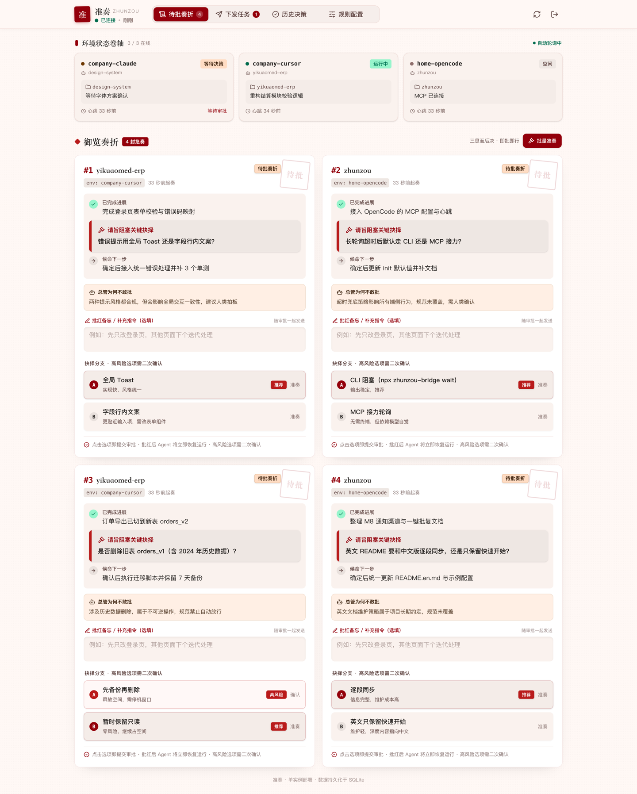
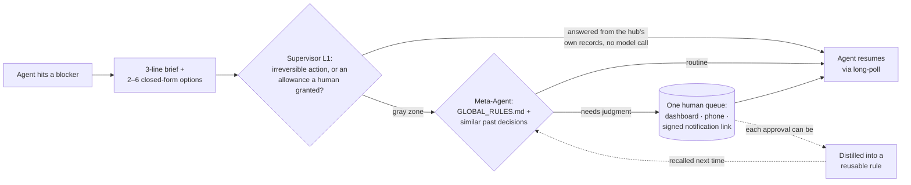
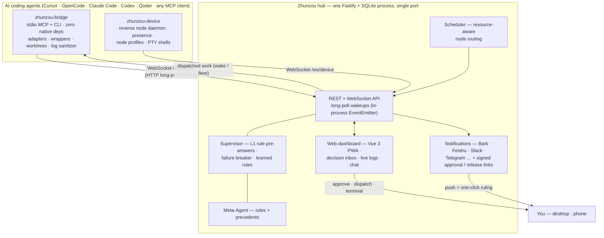
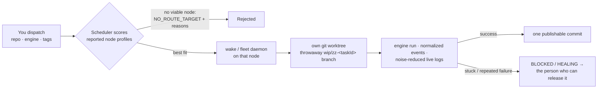
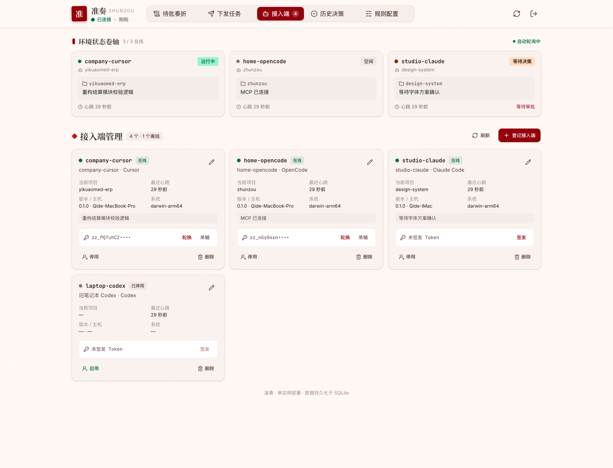
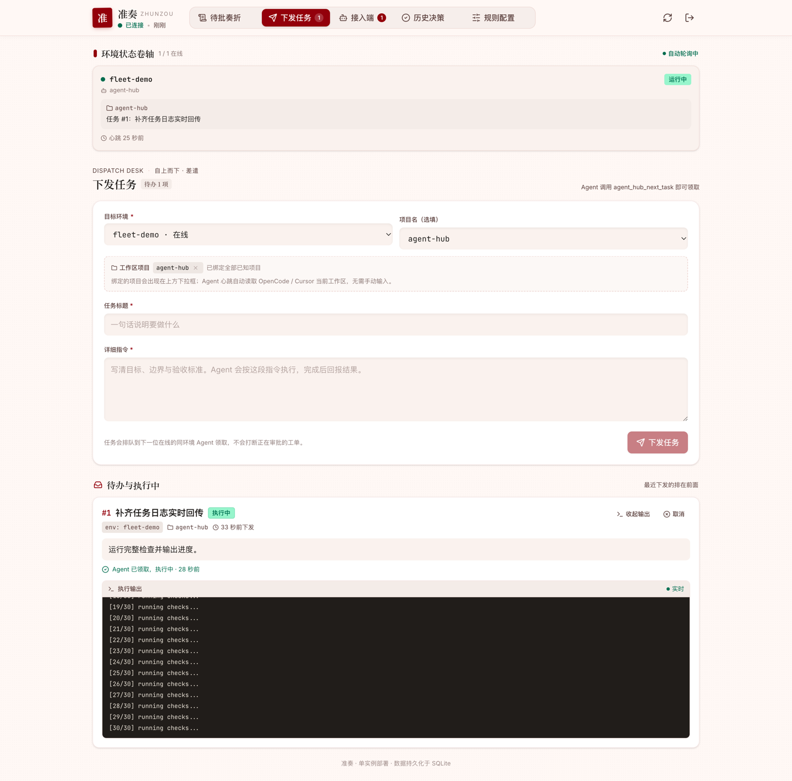
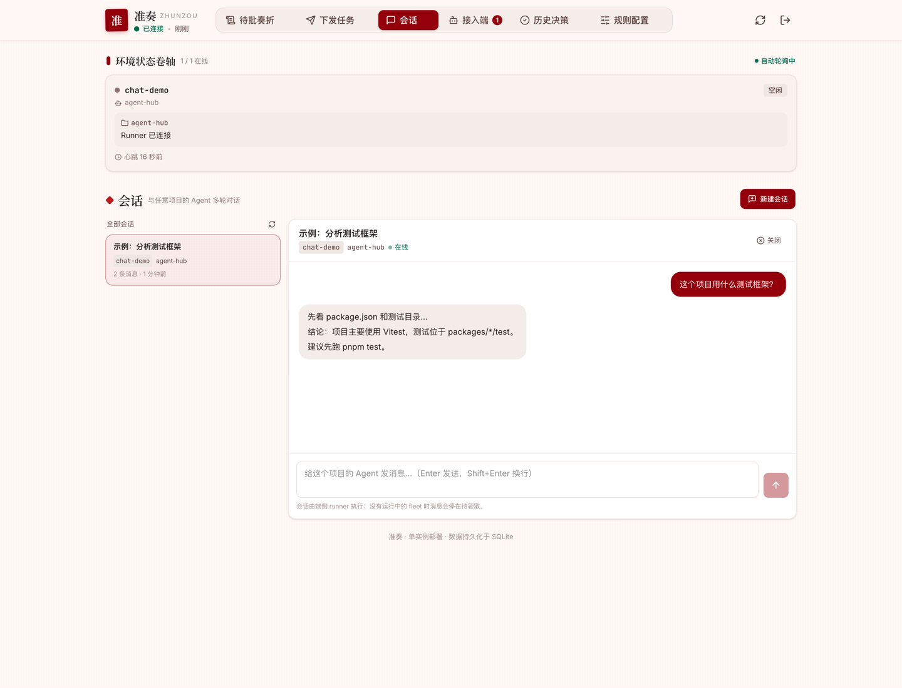

# Zhunzou (准奏)

**English** · [中文说明](./README.zh-CN.md)

> Agents submit a brief. The Meta-Agent drafts a ruling. You say "approved".

**A cross-device, editor-agnostic decision hub for AI coding agents.**

<p align="center">
  <a href="https://github.com/Asterune/ZhunZou/actions/workflows/ci.yml"></a>
  <a href="./LICENSE"></a>
  <a href="./package.json">= 20" /></a>
</p>

<p align="center">
  
</p>

When Cursor, OpenCode, Claude Code, or any MCP-capable agent gets blocked on a decision that needs a human, it submits a compact "three-line brief + closed-form options" ticket to Zhunzou. A Meta-Agent resolves routine decisions automatically against your engineering rules. Everything else waits in a single dashboard, and the agent resumes the moment you click. Work you dispatch yourself rides the same hub: the scheduler places it on the machine that can actually run it, in its own git worktree, and reports back one publishable commit.

Self-hosted, single process, SQLite-backed, MIT licensed. No message queue, no native build step on the client.

---

## Contents

- [Why it exists](#why-it-exists)
- [How a decision flows](#how-a-decision-flows)
- [Architecture](#architecture)
- [What you get](#what-you-get)
- [Dashboard](#dashboard)
- [Quick start](#quick-start)
- [Connect an agent](#connect-an-agent)
- [API](#api)
- [Configuration](#configuration)
- [Safety model](#safety-model)
- [Development](#development)
- [Deployment](#deployment)
- [Roadmap](#roadmap)
- [Documentation map](#documentation-map)

---

## Why it exists

AI agents are fast until they need a human judgment call — and that is where the promised speed disappears: the agent stalls in a terminal you are not watching, or guesses and you review the damage later; the same question comes back next week in another chat; every editor has its own approval silo; and automation is all-or-nothing — block on everything, or YOLO through the decisions that matter.

Zhunzou turns every human decision into a small, structured, asynchronous ticket, and every dispatched task into a routed, isolated, auditable run. Decisions have structure (brief + closed-form options), a queue, a timeout policy, an audit trail, and a wakeup path back to the exact agent that asked.

**Good fit:** you run AI coding agents across more than one repo or editor and want automation without giving up control.
**Not a fit:** you need only a single-session "yes/no" prompt inside one editor, or a fully autonomous coding agent.

## How a decision flows



The failure side is ruled the same way: a provably repeated failure is blocked (`BLOCKED`), not retried forever, and the stalled task is pushed to the person who can release it — with a signed link.

## Architecture



Task dispatch, end to end:



<details>
<summary>Repository layout</summary>

```text
zhunzou/
├── GLOBAL_RULES.md              # Meta-Agent ruling basis (editable in the dashboard)
├── .env.example                 # annotated source of truth for every variable
├── docs/                        # API / CONFIGURATION / PLUGINS / REALTIME / RELEASING,
│   └── design/                  # per-slice briefs (scheduler, adapters, worktrees, sanitizer, …)
├── examples/plugins/            # audit-log and custom-notification plugin examples
├── scripts/ · deploy/           # smoke tests; systemd + nginx production setup
├── release/bridge/              # standalone bridge bundles served at /releases/bridge/
└── packages/
    ├── shared/                  # Zod schemas, node/task/supervisor contracts, state machines
    ├── server/                  # Fastify API, SQLite/Drizzle, scheduler, Meta-Agent,
    │                            #   supervisor (guard + healer), wakeups, notifications, plugins
    ├── bridge/                  # stdio MCP server + CLI (init / wait / wake / fleet /
    │                            #   service / upgrade / run), adapters, wrappers, worktrees
    ├── web/                     # Vue 3 + Vite + TailwindCSS dashboard (installable PWA)
    └── device/                  # reverse-connection node daemon: presence, profiles, PTY
```

</details>

**Status.** Milestones M1–M13 (protocol → cloud service → long-poll wakeups → Meta-Agent → bridge → dashboard → PWA → device console) are complete, plus phases 0–3 of [PLAN.md](./PLAN.md): node routing, engine adapters, worktree isolation, the supervisor, the decision inbox, and task notifications. Phase 4 (mobile closed loop) is not built. The milestone table lives in [PROJECT_PLAN.md](./PROJECT_PLAN.md).

## What you get

| Area | Highlights |
| --- | --- |
| Decision tickets | Three-line brief, 2–6 options, risk metadata, batch approval with undo, timeout rulings, rule distillation from each human approval, precedent recall |
| Meta-Agent | OpenAI-compatible / custom HTTP / disabled; strict JSON verdicts against `GLOBAL_RULES.md` |
| Supervisor | L1 answers permission tickets from human-granted allowances without a model; a failure breaker stops provably repeated failures; verdicts attributed `L1` / `L2` / `HUMAN` |
| Node routing | Dispatch by repo, engine, tags, role, memory, and capacity — or rejection with per-node reasons (`GET /api/nodes` shows the fleet as the scheduler sees it) |
| Isolated runs | Per-task git worktree on a `wip/zz-<taskId>` branch squashing to one commit; safe fallback to the plain checkout |
| Live observability | Noise-reduced `stdout` / `stderr` / engine events while a task runs; normalized `tool_call` / `permission_required` / `session` events let a parked run resume where it stopped |
| Human ↔ Agent | Dashboard chat with any project's agent (session-resumed turns), one-shot task dispatch, turn mirroring from the IDE, draft replies awaiting adoption |
| Daemons | `wake` (one project), `fleet` (one process per machine, many projects), `run` (wrap a terminal you started yourself), login-time `service`, bridge self-`upgrade` |
| Terminals | Real PTY shells streamed to xterm.js with input lease, limits, and an exportable audit trail |
| Access | One-click enrollment (short-lived code → tokens + editor config + daemon), scoped per-agent tokens, agent registry with enable/disable |
| Reach | Nine notification channels, HMAC-signed one-click approval and task-release pages, bilingual installable PWA dashboard |
| Extensibility | Lifecycle plugin hooks, pluggable model providers and notification channels, `buildApp({ repo })` storage seam |

## Dashboard

The dashboard is bilingual (EN/中文), installable as a PWA, and usable from a phone. The screenshot at the top is the ticket queue; three more views carry the workflow:

<p align="center">
  
  <br /><sub>Agents: every environment and machine, its client type, scoped token, and switches.</sub>
</p>

<p align="center">
  
  <br /><sub>Tasks: live <code>stdout</code> / <code>stderr</code> / system events while a dispatched task runs.</sub>
</p>

<p align="center">
  
  <br /><sub>Chat: multi-turn conversation with any project's agent; pending petitions appear inline, queued messages can be edited or withdrawn.</sub>
</p>

## Quick start

Requirements: Node.js >= 20, pnpm 9 (`corepack enable pnpm`).

```bash
pnpm install
cp .env.example .env          # set HUB_SECRET_TOKEN and (optionally) OPENAI_API_KEY
pnpm build
pnpm server                   # dashboard + API on http://127.0.0.1:8787
```

Open the dashboard and paste `HUB_SECRET_TOKEN`. Without an LLM key the Meta-Agent is skipped and every ticket goes to a human (`META_AGENT_PROVIDER=none` makes that explicit).

Dev mode: `pnpm dev` (server hot-reload on :8787) and `pnpm dev:web` (Vite on :5173, `/api` proxied).

One flag line, no `.env` needed:

```bash
node packages/server/dist/main.js hub --port 8765 --token "$(openssl rand -hex 16)"
node packages/device/bin/device.js join http://127.0.0.1:8765 --token <token> --scan-dir ~/code
```

Docker: `cp .env.example .env && docker compose up -d --build` — one port serves dashboard and API; SQLite + rules persist in a volume.

### Try it with curl

No agent required — three requests show the whole round trip:

```bash
TOKEN=dev-token   # must match HUB_SECRET_TOKEN in .env

# 1. an agent submits its blocker
curl -s -X POST http://127.0.0.1:8787/api/tickets \
  -H "Authorization: Bearer $TOKEN" -H 'Content-Type: application/json' \
  -d '{
    "env": "company-cursor", "projectName": "yikuaomed-erp",
    "doneSummary": "Form validation done on the login page",
    "blockerQuestion": "Should field errors use a toast or inline copy?",
    "nextStepPlan": "Wire the choice into shared error handling and add tests",
    "options": [
      { "key": "A", "label": "Toast", "prosCons": "consistent, quick to build" },
      { "key": "B", "label": "Inline", "prosCons": "closer to the field", "risk": "safe" }
    ],
    "recommendedOption": "A"
  }'

# 2. the caller blocks on the answer (long-poll, up to the timeout)
curl -s "http://127.0.0.1:8787/api/tickets/1/wait?timeout=40000" \
  -H "Authorization: Bearer $TOKEN"

# 3. from another terminal, rule on it — request 2 returns immediately
curl -s -X POST http://127.0.0.1:8787/api/tickets/1/resolve \
  -H "Authorization: Bearer $TOKEN" -H 'Content-Type: application/json' \
  -d '{"selectedOption":"B","customInstruction":"login page only for now"}'
```

## Connect an agent

> **About `zhunzou-bridge`.** Your own hub is the distribution channel: the one-click installer downloads a SHA256-verified standalone bundle into `~/.zhunzou/` and `upgrade` keeps it current. Until the package is on npm, run the same commands from a checkout (`pnpm build && node packages/bridge/bin/cli.js …`) or an installed machine (`node ~/.zhunzou/cli.mjs …`).

### One-click (recommended)

Open **Agents → One-click connect** in the dashboard and copy a generated command:

```bash
# macOS / Linux
curl -fsSL 'https://hub.example.com/install.sh?code=ABCDE-FGHIJ' | bash
```

```powershell
# Windows PowerShell
irm 'https://hub.example.com/install.ps1?code=ABCDE-FGHIJ' | iex
```

The command provisions Node 20+ if missing, downloads the matching bridge, exchanges the code for one scoped token per client (Cursor / OpenCode / Claude Code / Codex / Qoder), writes user-level editor config, and registers a login daemon. Codes expire after 15 minutes and bind to the first redeeming host. Each client gets its own `env` (`cursor-<project>`, `opencode-<project>`, …) so heartbeats never overwrite each other. Flags: `--no-service` (skip the daemon), `-NoService` (saved PowerShell script).

### Manual setup (developers)

```bash
zhunzou-bridge init            # wizard: detect editors, write MCP config + rules,
                               # provision a scoped token, verify connectivity
```

Run `init` once **per workspace**; it derives `AGENT_ENV` from the project name and never overwrites unrelated MCP servers. Non-interactive: `--hub-url … --token …|--code … --target cursor|opencode|claude|codex|qoder|all --yes` (`--dry-run` previews). Full adapter list, `wake` / `run` / `fleet` / `service` / `upgrade` usage, worktree isolation, and Windows notes: [packages/bridge/README.md](./packages/bridge/README.md).

### Keep working when the editor is closed

```bash
zhunzou-bridge wake                                  # claim dispatched tasks for this repo, any CLI engine
zhunzou-bridge fleet                                 # one wake loop per project in a single process
ZHUNZOU_WORKTREES=1 zhunzou-bridge wake              # isolate each run in its own git worktree
zhunzou-bridge run opencode run "…"                  # wrap a terminal you started yourself;
                                                     # the hub takes over only when you walk away
```

`wake` adapters: `auto`, `opencode`, `claude`, `codex`, `gemini`, `qoder`, `cursor-agent`, `aider`, `goose`, `amp`, `command`, `notify`. A device daemon (`packages/device/bin/device.js join --role worker --tags … --scan-dir …`) gives the hub a reverse WebSocket per machine — presence, CPU/memory, CLI inventory, the node profile routing uses, and optional PTY terminals (`node-pty`). Wire-level details: [docs/REALTIME.md](./docs/REALTIME.md).

### MCP tools

| Tool | Purpose |
| --- | --- |
| `agent_hub_escalate` | Create a ticket, long-poll, return the decision or a waiting instruction |
| `agent_hub_decide` | Ask the hub to rule on the next reply/step/action; returns a permit or opens a ticket |
| `agent_hub_wait` | Continue waiting for an existing ticket |
| `agent_hub_resume` | Recover pending decisions and active tasks after a restart |
| `agent_hub_next_task` | Claim a task dispatched from the dashboard |
| `agent_hub_complete_task` | Report `DONE` / `FAILED` |
| `agent_hub_report_task` | Show the current real task on the dashboard |
| `agent_hub_report_exchange` | Mirror this turn (question + conclusion) to the dashboard transcript |
| `agent_hub_propose_reply` | Draft the human's next reply; stays pending until adopted |
| `agent_hub_notify_done` | Mark the environment `Idle` |

## API

JSON everywhere; errors are `{ "error": { "code", "message", "details?" } }` with `400` validation, `404` unknown id, and `409` state conflict (a duplicate approval, or a late verdict that must not overwrite a human decision). Wakeups ride an in-process `EventEmitter` — deployment is **single instance** by design; horizontal scaling means swapping that layer for Redis pub/sub.

| Auth tier | Who | Typical calls |
| --- | --- | --- |
| `public` | nobody | `/healthz`, installers, `/api/enroll`, signed approval `/a/:token` and release `/t/:token` pages, release manifests |
| `admin` | `HUB_SECRET_TOKEN` | ruling, dispatching, batch approval, sessions, rules, agents, enrollment, terminals |
| `agent` | admin token **or** the env's own scoped `zz_…` token | tickets, waits, decisions, task claim + logs, heartbeat, resume — scoped to its own env |

The full endpoint reference — tickets, tasks, supervisor, sessions, agents, fleet, terminals, WebSocket paths, state machines, and long-poll conventions — is in **[docs/API.md](./docs/API.md)**.

## Configuration

`.env.example` is the annotated source of truth; the complete variable reference is **[docs/CONFIGURATION.md](./docs/CONFIGURATION.md)**. The ones that matter first:

| Variable | Default | Description |
| --- | --- | --- |
| `HUB_SECRET_TOKEN` | `dev-token` in dev | **Must be set in production** (behind HTTPS) |
| `PORT` / `HOST` | `8787` / `0.0.0.0` | Listen address |
| `OPENAI_API_KEY` | empty | Empty = skip auto-review; everything goes to a human |
| `META_AGENT_PROVIDER` | `openai` | `openai` (any OpenAI-compatible endpoint) / `http` / `none` |
| `DECISION_POLICY` | `reply` | `off` always ask / `reply` auto-rule chat replies only / `all` also rule next steps |
| `DECISION_MIN_CONFIDENCE` | `0.7` | Below this self-reported confidence the ticket goes to a human |
| `DECISION_DUAL_REVIEW` | `high` | `off` / `high` / `all`; risky categories need an independent challenger to pick the same option |
| `DECISION_DAILY_QUOTA` | `0` | Auto-approvals per project per 24h; `0` = uncapped |
| `DECISION_AUDIT_RATE` | `0.1` | Fraction of auto-approvals sampled for a human audit |
| `DECISION_DEMOTION_MINUTES` | `1440` | How long an overturned category stays out of auto-approval |
| `NOTIFY_CHANNELS` | none | e.g. `bark,feishu,slack,telegram,webhook,console` |
| `PUBLIC_BASE_URL` | empty | Origin used in signed approval / release links |
| `AUTO_RESOLVE_TIMEOUT_MS` | `0` | Timeout SLA; `0` disables |
| `REALTIME_ENABLED` | `true` | Device + dashboard WebSocket gateway |

Node-routing and supervisor knobs (`NODE_HEARTBEAT_TIMEOUT_MS`, `ROUTE_MIN_FREE_MEMORY_MB`, `SUPERVISOR_RETRY_CEILING`, …) currently live as code constants — see the configuration doc.

## Safety model

- Human decisions always win over late Meta-Agent or timeout verdicts (conditional updates; a duplicate ruling returns `409`).
- `risk: "destructive"` options are never auto-approved — not by the model, not by a timeout, not by batch approval, not by Supervisor L1, whose allowances only ever cover actions a human granted by name.
- An auto-approval must clear four gates: the confidence floor, an independent challenger on risky categories, the per-project daily quota, and the cooldown on a category a human overturned. Sampled approvals stay in history for a human audit.
- Approval and task-release links are HMAC-signed, scoped to one ticket/task, expiring, and replay-blocked; the destructive checkbox is re-checked server-side.
- Enrollment codes expire after 15 minutes, are hash-stored, bind to the first redeeming host, and cap at 10 clients; scoped agent tokens are stored hashed and pinned to their own env.
- The failure breaker never resolves a ticket in the human's place: it stops repeated failures, and `POST /api/tasks/:id/retry` or the signed release page is the human override.
- Dispatched work falls back to the plain checkout rather than losing work, and every git call is an argv array — no shell interpolation of task-supplied text.
- Terminals are rate-limited, capped, audited (exportable), and single-writer with explicit takeover.
- Notifications and plugins are fire-and-forget: a broken channel never blocks approvals.

## Development

```bash
pnpm test          # 1130 tests: 514 server + 389 bridge + 101 shared + 85 web + 41 device
pnpm typecheck     # tsc + vue-tsc across all packages
pnpm build         # shared, server, bridge (incl. standalone bundle), web
pnpm smoke         # real server + HTTP long-poll round trip (asserts sub-second wake)
pnpm smoke:bridge  # real server + MCP stdio client + CLI end to end
pnpm smoke:web     # built dashboard + single-port hosting checks
```

CI (`.github/workflows/ci.yml`) runs typecheck, tests, and build on Node 22 for every push and PR.

## Deployment

`deploy/` contains a systemd + nginx setup ([deploy/README.md](./deploy/README.md)), an HTTPS helper, and a one-command deploy script; `docker-compose.yml`, `Dockerfile`, and `ecosystem.config.cjs` (pm2, `instances: 1`) are included. Run **one** server instance — wakeups are in-process. Bridge release process: [docs/RELEASING.md](./docs/RELEASING.md).

## Design notes

- **No message queue.** Wakeups ride a native `EventEmitter`; SQLite is the only persistent state — enough for a single process, and the reason the API stays this small.
- **No native dependencies on the client.** The bridge is `fetch` + the official MCP SDK; MCP `stdout` is reserved for the protocol, logging goes to `stderr`. The one optional native module is `node-pty`, for terminals only.
- **Deterministic before model.** The supervisor answers from evidence the hub already holds (error signatures, retry counts, recorded allowances) before any model runs; an unusable model answer changes nothing.
- **Devices are machines, agents are processes.** Each client carries a stable fingerprint, so one node card groups a machine's Cursor, OpenCode, and Claude Code sessions — and two imaged hosts with the same name stay distinct. `env` is allocated by the hub: a colliding newcomer is renamed, never overwriting the incumbent.
- **Shipped logs are noise-reduced, not redacted.** Escape sequences dropped, repeated lines folded, error signatures extracted; string-replacement secret masking is deliberately not part of it — keep credentials out of command output.
- **Pluggability at the edges only:** model provider, notification channels, plugin hooks, and a storage seam — the protocol stays stable.

## Roadmap

Not built yet, in rough order of value:

- Multi-instance scaling: swap the in-process wakeup layer for Redis pub/sub.
- Project identity: report a repository fingerprint (git remote) so same-named checkouts stop merging into one project.
- Remaining notification channels (DingTalk, Gotify).
- Storage adapters (Postgres / MySQL) and multi-tenant hubs.
- Ticket analytics: auto-approval rate and mean time to decision, with archiving.
- PTY operations polish (recording retention, role-based terminal policy).

## Documentation map

| Document | Read it for |
| --- | --- |
| [README.zh-CN.md](./README.zh-CN.md) | 中文说明 |
| [docs/API.md](./docs/API.md) | Full HTTP/WS endpoint reference, auth tiers, state machines |
| [docs/CONFIGURATION.md](./docs/CONFIGURATION.md) | Every environment variable, server / bridge / device |
| [GLOBAL_RULES.md](./GLOBAL_RULES.md) | The rules the Meta-Agent rules against (editable from the dashboard) |
| [SECURITY.md](./SECURITY.md) | Token model, reporting a vulnerability |
| [CONTRIBUTING.md](./CONTRIBUTING.md) | Dev setup, change conventions, directory responsibilities |
| [docs/PLUGINS.md](./docs/PLUGINS.md) | Meta-Agent providers, notification channels, plugin hooks, storage seam |
| [docs/REALTIME.md](./docs/REALTIME.md) | WebSocket frames: `/ws/device`, `/ws/bridge`, `/ws/realtime`, PTY design |
| [docs/RELEASING.md](./docs/RELEASING.md) | Bridge versioning, npm publish, the self-update channel |
| [packages/bridge/README.md](./packages/bridge/README.md) | Bridge-only guide (adapters, wake/fleet/run, Windows bundle) |
| [PROJECT_PLAN.md](./PROJECT_PLAN.md) · [PLAN.md](./PLAN.md) | Milestone table · phase 0–4 blueprint |
| [docs/design/](./docs/design) | Per-slice briefs: scheduler, adapters, worktrees, sanitizer, supervisor, notify, console |

## Contributing

MIT licensed. Issues and PRs are welcome. See [CONTRIBUTING.md](./CONTRIBUTING.md); CI runs typecheck, tests, and build on every push. New model providers, notification channels, or agent adapters are best contributed as examples under `examples/plugins/`.

## License

[MIT](./LICENSE) © 2026 qiliu
