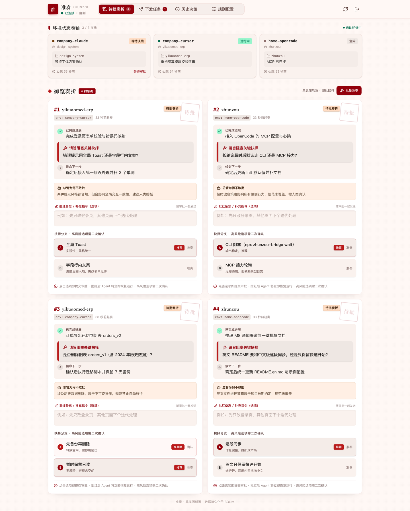
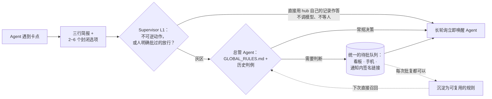
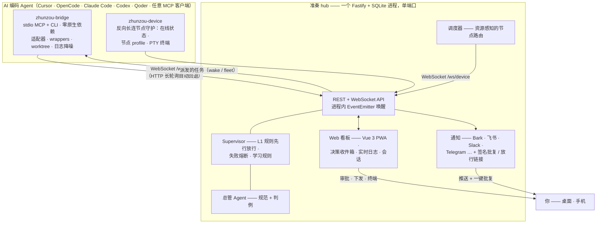
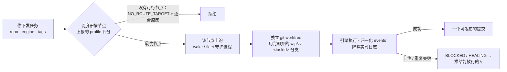
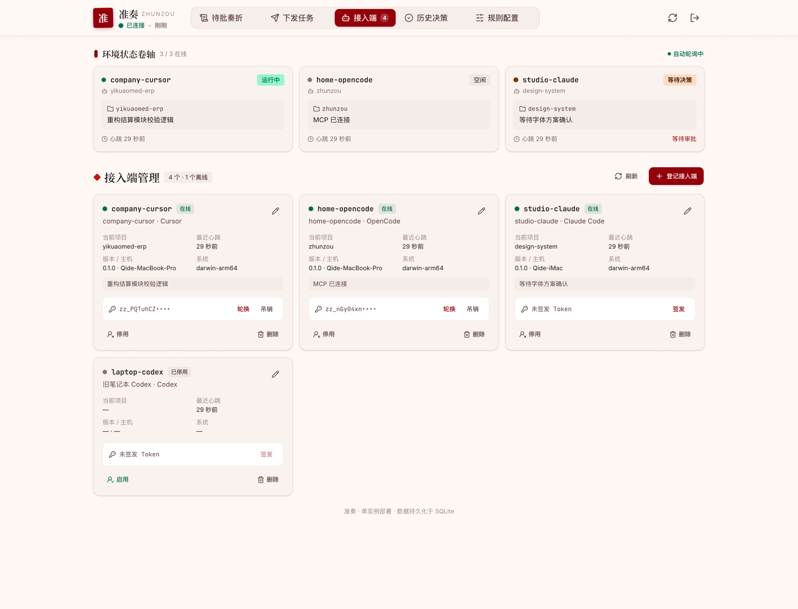
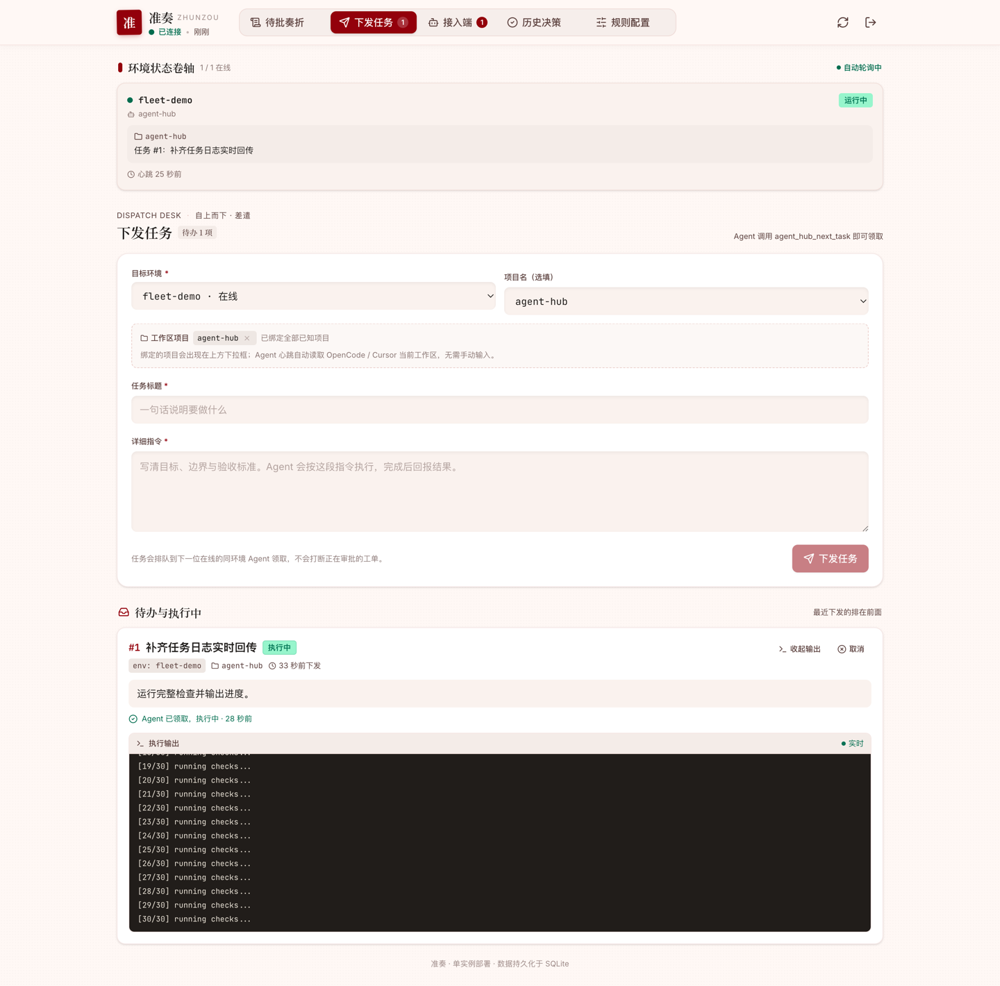
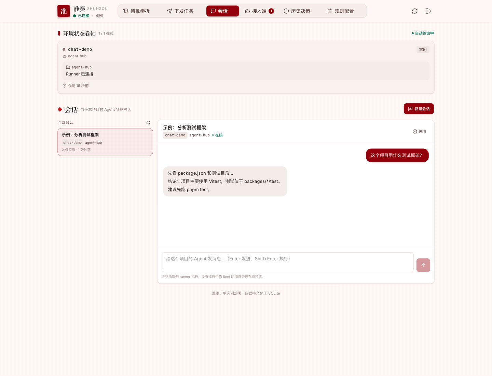

# 准奏（Zhunzou）

[English](./README.md) · 中文

> Agent 上奏，总管拟票，你一句「准奏」。

**跨设备、不绑定编辑器的 AI 编码 Agent 决策中枢。**

<p align="center">
  <a href="https://github.com/Asterune/ZhunZou/actions/workflows/ci.yml"></a>
  <a href="./LICENSE"></a>
  <a href="./package.json">= 20" /></a>
</p>

<p align="center">
  
</p>

当 Cursor、OpenCode、Claude Code 或任意 MCP Agent 卡在需要人类拍板的决定上时，它把问题压缩成「三行简报 + 封闭选项」提交到准奏；总管 Agent 按你的工程规范自动裁决常规决策，其余全部进入一个看板，你点一下，等待中的 Agent 立刻恢复执行。你主动派下的活也走同一个 hub：调度器把它放到真正能跑的机器上，每次运行独占一个 git worktree，最后只交回一个可发布的提交。

自托管、单进程、SQLite 持久化、MIT 协议。没有消息队列，端侧没有原生编译步骤。

---

## 目录

- [它解决什么问题](#它解决什么问题)
- [一次决策怎么走](#一次决策怎么走)
- [架构](#架构)
- [能力一览](#能力一览)
- [看板](#看板)
- [快速开始](#快速开始)
- [接入 Agent](#接入-agent)
- [API](#api)
- [配置](#配置)
- [安全模型](#安全模型)
- [开发](#开发)
- [部署](#部署)
- [后续可选增强](#后续可选增强)
- [文档地图](#文档地图)

---

## 它解决什么问题

AI Agent 写代码很快，但一到「需要人类拍板」就慢下来：Agent 卡在你没盯着的终端里一停就是几小时；或者它先猜、你事后擦屁股；决策只活在某个聊天记录里，下周又被问一遍；每个编辑器各有一套「等人」的方式；自动化只有全有或全无——要么每问必卡，要么 YOLO 一路放行。

准奏把每一次「需要人拍板」变成结构化、可异步处理的小工单，把你派下的每一个任务变成有路由、有隔离、有审计的运行：决策有结构（简报 + 封闭选项）、有队列、有超时策略、有审计，也有精准唤醒当初提问的那个 Agent 的通路。

**适合：** 你跨多个仓库 / 编辑器跑 AI Agent，想要自动化但不放弃控制权。
**不适合：** 你只需要单会话的「是 / 否」确认，或你想要一个完全自治的编码 Agent。

## 一次决策怎么走



失败侧同理：被证据证明会重复的失败会被拦下（`BLOCKED`），不是一直重试；卡住的任务会带着签名放行链接，推给能放行的人。

## 架构



任务派发，从下单到交活：



<details>
<summary>目录结构</summary>

```text
zhunzou/
├── GLOBAL_RULES.md              # 总管 Agent 的预审依据（看板可在线编辑）
├── .env.example                 # 全部变量的带注释源头
├── docs/                        # API / CONFIGURATION / PLUGINS / REALTIME / RELEASING
│   └── design/                  # 各切片简报：调度器、适配器、worktree、降噪……
├── examples/plugins/            # 审计日志 / 自定义通知插件示例
├── scripts/ · deploy/           # 冒烟测试；systemd + nginx 生产部署
├── release/bridge/              # standalone bridge 发布产物（/releases/bridge/）
└── packages/
    ├── shared/                  # Zod Schema、节点/任务/Supervisor 协议契约与状态机
    ├── server/                  # Fastify API、SQLite/Drizzle、调度器、总管 Agent、
    │                            #   Supervisor（guard + healer）、唤醒、通知、插件
    ├── bridge/                  # 端侧 MCP Server + CLI（init / wait / wake / fleet /
    │                            #   service / upgrade / run）、适配器、worktree、降噪
    ├── web/                     # Vue 3 + Vite + TailwindCSS 看板（可安装 PWA）
    └── device/                  # 反向长连节点守护：在线状态、profile、PTY
```

</details>

**当前状态：** 里程碑 M1–M13（共享协议 → 云端服务 → 长轮询 → 总管 Agent → 桥接 → 看板 → PWA → 设备终端）全部完成，[PLAN.md](./PLAN.md) 蓝图的阶段 0–3（节点路由、引擎适配、worktree 隔离、Supervisor、决策收件箱、任务通知）也已落地；阶段 4（移动端闭环）尚未实现。里程碑表见 [PROJECT_PLAN.md](./PROJECT_PLAN.md)。

## 能力一览

| 领域 | 要点 |
| --- | --- |
| 决策工单 | 三行简报、2~6 个选项、风险标注、批量审批（3 秒撤销）、超时默认裁决、批复沉淀为规则、判例召回 |
| 总管 Agent | OpenAI 兼容 / 自定义 HTTP / 关闭；按 `GLOBAL_RULES.md` 输出严格 JSON 裁决 |
| Supervisor | L1 用人工授予的放行规则 0ms 作答权限请求，不调模型；失败熔断拦下可证明的重复失败；裁决标注 `L1` / `L2` / `HUMAN` |
| 节点路由 | 按 repo、引擎、tags、角色、内存、并发派发；放不下时报 `NO_ROUTE_TARGET` 并逐台列原因（`GET /api/nodes` 看调度器眼中的机群） |
| 隔离运行 | 每个任务独占 `.zhunzou/wt/<taskId>` worktree，压成一个提交；出问题时安全回退到普通 checkout |
| 实时观测 | 降噪后的 `stdout` / `stderr` / engine events 实时流；`tool_call` / `permission_required` / `session` 归一化事件让 parked run 原地续跑 |
| 人 ↔ Agent | 看板与任意项目 Agent 多轮会话（按 session 续跑）、单次任务下发、IDE 轮次镜像、替人起草的回复草稿 |
| 守护进程 | `wake`（单项目）、`fleet`（一进程多项目）、`run`（包裹你自己起的终端）、登录自启 `service`、bridge 自更新 |
| 交互终端 | 真 PTY shell 流到 xterm.js，输入权唯一、限额、审计可导出 |
| 接入管理 | 一键接入码（Token + 编辑器配置 + 守护进程）、每 Agent 专属 scoped Token、接入端注册与启停 |
| 触达 | 9 种通知渠道、HMAC 签名的一键批复 / 放行页、中英双语可安装 PWA 看板 |
| 扩展 | 生命周期插件钩子、可替换的模型提供方与通知渠道、`buildApp({ repo })` 存储缝 |

## 看板

看板中英双语、可安装为 PWA、手机上可直接操作。顶部截图是待批队列，另外三个视图承载完整工作流：

<p align="center">
  
  <br /><sub>接入端：每个环境与机器的客户端类型、专属 Token 与开关。</sub>
</p>

<p align="center">
  
  <br /><sub>任务：下发任务运行中的实时 <code>stdout</code> / <code>stderr</code> / 系统事件。</sub>
</p>

<p align="center">
  
  <br /><sub>会话：与任意项目 Agent 多轮对话；待批奏折内嵌在消息流里，排队消息可编辑可撤回。</sub>
</p>

## 快速开始

要求：Node.js >= 20、pnpm 9（`corepack enable pnpm`）。

```bash
pnpm install
cp .env.example .env          # 填入 HUB_SECRET_TOKEN /（可选）OPENAI_API_KEY
pnpm build
pnpm server                   # 看板 + API 同在 http://127.0.0.1:8787
```

浏览器打开看板，粘贴 `HUB_SECRET_TOKEN` 即可。未配置 LLM Key 时总管 Agent 自动跳过预审，所有工单直接转人工（`META_AGENT_PROVIDER=none` 可显式声明）。

开发模式：`pnpm dev`（服务端热重载 :8787）、`pnpm dev:web`（Vite :5173，`/api` 自动代理）。

不依赖 `.env` 的一行启动：

```bash
node packages/server/dist/main.js hub --port 8765 --token "$(openssl rand -hex 16)"
node packages/device/bin/device.js join http://127.0.0.1:8765 --token <token> --scan-dir ~/code
```

Docker：`cp .env.example .env && docker compose up -d --build`——单端口托管看板与 API，SQLite 与规则持久化在卷里。

### 用 curl 走一遍完整流程

不需要 Agent，三个请求看完整轮往返：

```bash
TOKEN=dev-token   # 与 .env 中的 HUB_SECRET_TOKEN 保持一致

# 1. 提交卡点工单
curl -s -X POST http://127.0.0.1:8787/api/tickets \
  -H "Authorization: Bearer $TOKEN" -H 'Content-Type: application/json' \
  -d '{
    "env": "company-cursor", "projectName": "yikuaomed-erp",
    "doneSummary": "完成登录页表单校验",
    "blockerQuestion": "错误提示用 Toast 还是行内文案？",
    "nextStepPlan": "确定后接入统一错误处理并补测试",
    "options": [
      { "key": "A", "label": "Toast 提示", "prosCons": "统一、实现快" },
      { "key": "B", "label": "行内文案", "prosCons": "更贴近字段" }
    ],
    "recommendedOption": "A"
  }'

# 2. 端侧长轮询（会挂起最多 40s）
curl -s "http://127.0.0.1:8787/api/tickets/1/wait?timeout=40000" \
  -H "Authorization: Bearer $TOKEN"

# 3. 另一个终端：人类审批，请求 2 立即被唤醒
curl -s -X POST http://127.0.0.1:8787/api/tickets/1/resolve \
  -H "Authorization: Bearer $TOKEN" -H 'Content-Type: application/json' \
  -d '{"selectedOption":"B","customInstruction":"先只改登录页"}'
```

## 接入 Agent

> **关于 `zhunzou-bridge` 从哪来。** 你自己的 hub 就是分发渠道：一键安装会把校验过 SHA256 的 standalone bundle 装进 `~/.zhunzou/`，`upgrade` 负责保持最新。npm 包正式发布前，请从仓库运行（`pnpm build && node packages/bridge/bin/cli.js …`），或在一台已装好的机器上 `node ~/.zhunzou/cli.mjs …`。

### 一键接入（推荐）

看板打开「接入端 → 一键接入」，复制生成的命令：

```bash
# macOS / Linux
curl -fsSL 'https://hub.example.com/install.sh?code=ABCDE-FGHIJ' | bash
```

```powershell
# Windows PowerShell
irm 'https://hub.example.com/install.ps1?code=ABCDE-FGHIJ' | iex
```

这条命令会自动准备 Node 20+、拉取对应版本的 bridge、用接入码为**每个客户端**换取专属 scoped Token、写入用户级编辑器配置、安装登录自启守护进程。接入码 15 分钟有效、绑定首次兑换的主机、最多 10 个客户端。每个客户端有独立 env（`cursor-<项目>`、`opencode-<项目>`……），心跳不再互相覆盖。可加 `--no-service`（PowerShell 存脚本后用 `-NoService`）跳过常驻服务。

### 手动接入（开发者）

```bash
zhunzou-bridge init            # 向导：检测编辑器、写 MCP 配置与规则、
                               # 签发专属 Token、校验连通性
```

每个工作区跑一次 `init`；它按项目名派生 `AGENT_ENV`，绝不覆盖无关的 MCP server。非交互：`--hub-url … --token …|--code … --target cursor|opencode|claude|codex|qoder|all --yes`（`--dry-run` 只预览）。适配器全表、`wake` / `run` / `fleet` / `service` / `upgrade` 用法、worktree 隔离与 Windows 说明见 [packages/bridge/README.md](./packages/bridge/README.md)。

### 编辑器关了也能干活

```bash
zhunzou-bridge wake                                  # 领取下发任务，唤醒本机任意 CLI 引擎
zhunzou-bridge fleet                                 # 一个进程跑本机所有项目的 wake 循环
ZHUNZOU_WORKTREES=1 zhunzou-bridge wake              # 每次运行隔离进独立 git worktree
zhunzou-bridge run opencode run "…"                  # 包裹你自己起的终端，
                                                     # 你走开之后 hub 才接管
```

`wake` 适配器：`auto` / `opencode` / `claude` / `codex` / `gemini` / `qoder` / `cursor-agent` / `aider` / `goose` / `amp` / `command` / `notify`。设备守护进程（`packages/device/bin/device.js join --role worker --tags … --scan-dir …`）给 hub 一条每机器的反向 WebSocket——在线状态、CPU/内存、CLI 清单、路由用的节点 profile，外加可选的 PTY 终端（`node-pty`）。帧级细节见 [docs/REALTIME.md](./docs/REALTIME.md)。

### MCP 工具

| Tool | 作用 |
| --- | --- |
| `agent_hub_escalate` | 创建工单 → 长轮询 → 返回最终决策或等待引导 |
| `agent_hub_decide` | 让 hub 裁决下一步回复/动作；直接放行或开票转人工 |
| `agent_hub_wait` | 继续等待已有工单 |
| `agent_hub_resume` | 重启/重连后恢复未决工单与活跃任务 |
| `agent_hub_next_task` | 领取看板下发的任务 |
| `agent_hub_complete_task` | 回报 `DONE` / `FAILED` |
| `agent_hub_report_task` | 让看板显示当前真实任务 |
| `agent_hub_report_exchange` | 把本轮「人类提问 + Agent 结论」镜像到看板 |
| `agent_hub_propose_reply` | 替人起草下一句回复，采纳前不会真的发出 |
| `agent_hub_notify_done` | 上报 `Idle`，更新看板状态灯 |

## API

全部 JSON；错误统一 `{ "error": { "code", "message", "details?" } }`——`400` 校验失败、`404` 未知 id、`409` 状态冲突（重复审批，或迟到的预审结果不得覆盖人工决定）。唤醒走进程内 `EventEmitter`，所以部署**必须单实例**；水平扩展需把唤醒层换成 Redis pub/sub。

| 鉴权层 | 谁能调用 | 典型接口 |
| --- | --- | --- |
| `public` | 免鉴权 | `/healthz`、安装脚本、`/api/enroll`、签名批复页 `/a/:token`、签名放行页 `/t/:token`、发布清单 |
| `admin` | `HUB_SECRET_TOKEN` | 审批、下发、批量批复、会话、规则、接入端、接入码、终端 |
| `agent` | 管理员 Token 或该 env 的专属 `zz_…` Token | 工单、等待、决策、任务领取与日志、心跳、resume——锁定自己的 env |

完整端点参考——工单、任务、Supervisor、会话、接入端、fleet、终端、WebSocket、状态机与长轮询约定——见 **[docs/API.md](./docs/API.md)**。

## 配置

`.env.example` 是带注释的源头，全量变量参考见 **[docs/CONFIGURATION.md](./docs/CONFIGURATION.md)**。最先会用到的几个：

| 变量 | 默认值 | 说明 |
| --- | --- | --- |
| `HUB_SECRET_TOKEN` | 开发环境 `dev-token` | **生产环境必须显式设置**（并置于 HTTPS 之后） |
| `PORT` / `HOST` | `8787` / `0.0.0.0` | 监听地址 |
| `OPENAI_API_KEY` | 空 | 为空跳过自动预审，全部转人工 |
| `META_AGENT_PROVIDER` | `openai` | `openai`（任意兼容端点）/ `http` / `none` |
| `DECISION_POLICY` | `reply` | `off` 全部问人 / `reply` 只自动裁决会话回复 / `all` 连下一步动作也裁决 |
| `NOTIFY_CHANNELS` | 空 | 如 `bark,feishu,slack,telegram,webhook,console` |
| `PUBLIC_BASE_URL` | 空 | 签名批复 / 放行链接的公开地址 |
| `AUTO_RESOLVE_TIMEOUT_MS` | `0` | 超时默认裁决；`0` 关闭 |
| `REALTIME_ENABLED` | `true` | 设备 / 看板 WebSocket 网关 |

节点路由与 Supervisor 的旋钮（`NODE_HEARTBEAT_TIMEOUT_MS`、`ROUTE_MIN_FREE_MEMORY_MB`、`SUPERVISOR_RETRY_CEILING`……）目前是代码常量，见配置文档。

## 安全模型

- 人工决定永远优先：迟到的总管或超时结果不会覆盖已完成的审批（条件更新；重复批复返回 `409`）。
- `risk: "destructive"` 的选项永不自动通过——模型、超时、批量、Supervisor L1 都不行；L1 的放行规则只覆盖人明确批过的动作。
- 批复与放行链接 HMAC 签名、绑定单张工单/任务、会过期、防重放；destructive 勾选在服务端复核。
- 接入码 15 分钟过期、哈希存储、绑定首台主机、限 10 个客户端；专属 Token 哈希存储、锁定自己的 env。
- 失败熔断永远不替人解开工单：它只拦可证明的重复失败，出口是 `POST /api/tasks/:id/retry` 或签名放行页。
- 派发的工作在 worktree 建立不了时回退到普通 checkout 而不是丢工作；所有 git 调用都是 argv 数组，绝不拼接 shell。
- 终端有速率限制、并发上限、可导出的审计、单写者 + 显式接管。
- 通知与插件是 fire-and-forget：渠道故障永远不阻塞审批。

## 开发

```bash
pnpm test          # 1130 个测试：server 514 + bridge 389 + shared 101 + web 85 + device 41
pnpm typecheck     # 全量类型检查（tsc + vue-tsc）
pnpm build         # 全量构建（含 standalone bridge 与 Vue 看板）
pnpm smoke         # 真实服务 + HTTP 长轮询冒烟（断言亚秒级唤醒）
pnpm smoke:bridge  # 真实服务 + MCP stdio 客户端 + CLI 端到端
pnpm smoke:web     # 构建看板 + 单端口托管验收
```

CI（`.github/workflows/ci.yml`）在每次 push / PR 时跑 typecheck、测试与构建（Node 22）。

## 部署

`deploy/` 内含 systemd + nginx 方案（[deploy/README.md](./deploy/README.md)）、HTTPS 助手与一键部署脚本；另有 `docker-compose.yml`、`Dockerfile`、`ecosystem.config.cjs`（pm2，`instances: 1`）。只跑**一个**服务实例——唤醒是进程内的。bridge 发版流程见 [docs/RELEASING.md](./docs/RELEASING.md)。

## 设计说明

- **零消息队列**：唤醒用 Node 原生 `EventEmitter`，SQLite 只做持久化——够单进程规模，也是 API 能这么小的原因。
- **端侧零原生依赖**：bridge 只用 `fetch` + 官方 MCP SDK；MCP 的 stdout 严格留给协议，日志走 stderr。全系统唯一可选的原生模块是终端用的 `node-pty`。
- **先确定性、后模型**：hub 已掌握的证据（错误签名、重试次数、记录在案的放行）在任何模型调用之前定结论；不可用的模型答案什么都不改。
- **设备是机器，接入端是进程**：每个客户端带稳定指纹，一台机器上的 Cursor / OpenCode / Claude Code 归到一张节点卡，同名镜像机也分得开。`env` 由 hub 分配：撞名的后来者改名，不覆盖先来者。
- **日志降噪、不脱敏**：转义序列剥掉、重复行折叠、错误签名提取；刻意不做字符串替换式密钥遮蔽——凭据别进命令输出。
- **只在边缘可插拔**：模型提供方、通知渠道、插件钩子、存储缝——协议保持稳定。

## 后续可选增强

- 多实例水平扩展：把进程内唤醒层换成 Redis pub/sub。
- 项目身份：bridge 上报仓库指纹（git remote），拆散今天会合并成同一项目的同名仓库。
- 尚未内置的通知渠道（钉钉、Gotify）。
- 存储适配器（Postgres / MySQL）与多租户。
- 工单统计：自动放行率、平均决策耗时，含归档。
- 终端运维增强：录制留存、按角色的终端策略。

## 文档地图

| 文档 | 讲什么 |
| --- | --- |
| [README.md](./README.md) | English edition |
| [docs/API.md](./docs/API.md) | 完整 HTTP/WS 端点参考、鉴权分层、状态机 |
| [docs/CONFIGURATION.md](./docs/CONFIGURATION.md) | 全部环境变量：服务端 / bridge / 设备 |
| [GLOBAL_RULES.md](./GLOBAL_RULES.md) | 总管 Agent 的预审依据（看板可在线编辑） |
| [SECURITY.md](./SECURITY.md) | Token 模型、漏洞上报 |
| [CONTRIBUTING.md](./CONTRIBUTING.md) | 开发环境、变更约定、目录职责 |
| [docs/PLUGINS.md](./docs/PLUGINS.md) | 预审模型、通知渠道、插件钩子、存储缝 |
| [docs/REALTIME.md](./docs/REALTIME.md) | WebSocket 帧：`/ws/device`、`/ws/bridge`、`/ws/realtime`、PTY 设计 |
| [docs/RELEASING.md](./docs/RELEASING.md) | bridge 版本化、npm 发布、自更新渠道 |
| [packages/bridge/README.md](./packages/bridge/README.md) | bridge 专属指南（适配器、wake/fleet/run、Windows 包） |
| [PROJECT_PLAN.md](./PROJECT_PLAN.md) · [PLAN.md](./PLAN.md) | 里程碑表 · 阶段 0–4 蓝图 |
| [docs/design/](./docs/design) | 各切片简报：调度器、适配器、worktree、降噪、Supervisor、通知、终端 |

## 开源与贡献

MIT 协议，欢迎 Issue / PR。贡献指南见 [CONTRIBUTING.md](./CONTRIBUTING.md)；新的模型提供方、通知渠道或 Agent 适配器，欢迎整理成 `examples/plugins/` 下的示例提交回来。

## 许可

[MIT](./LICENSE) © 2026 qiliu
