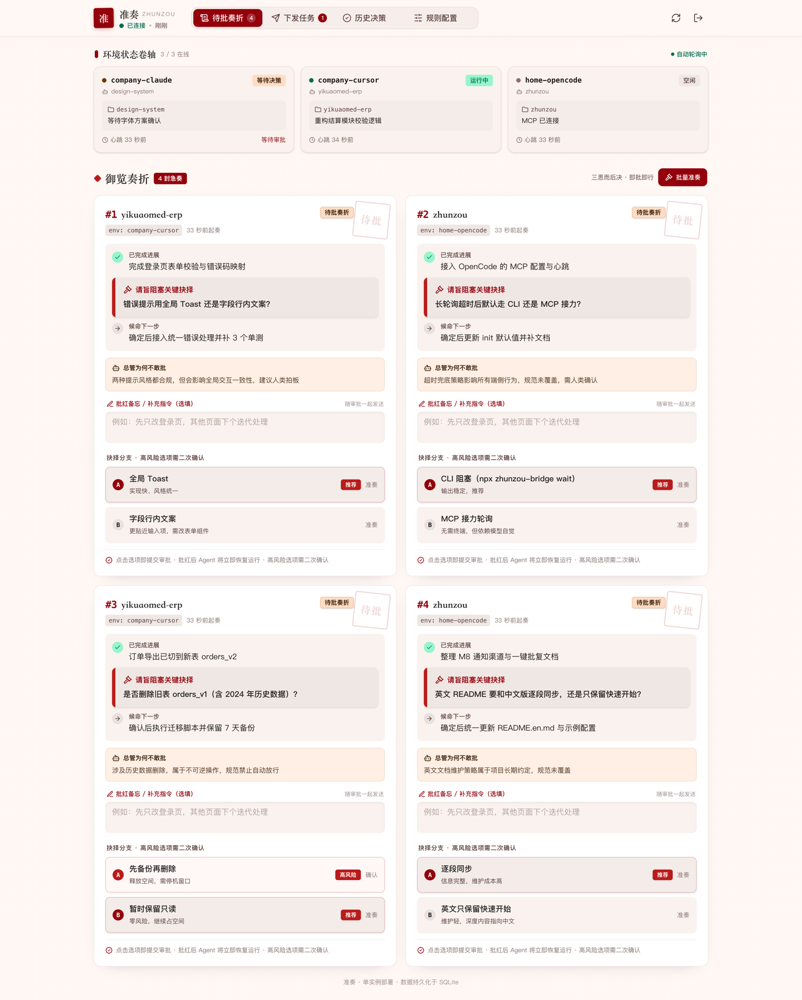
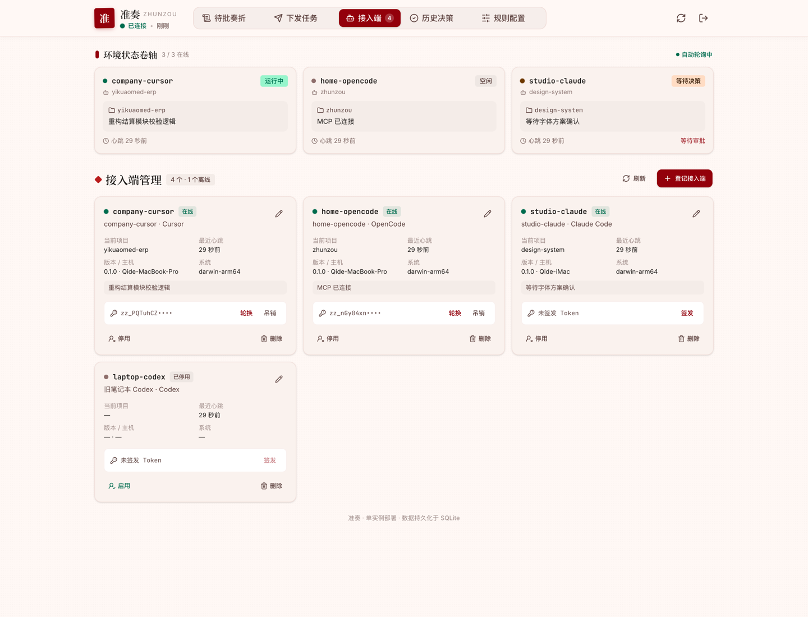
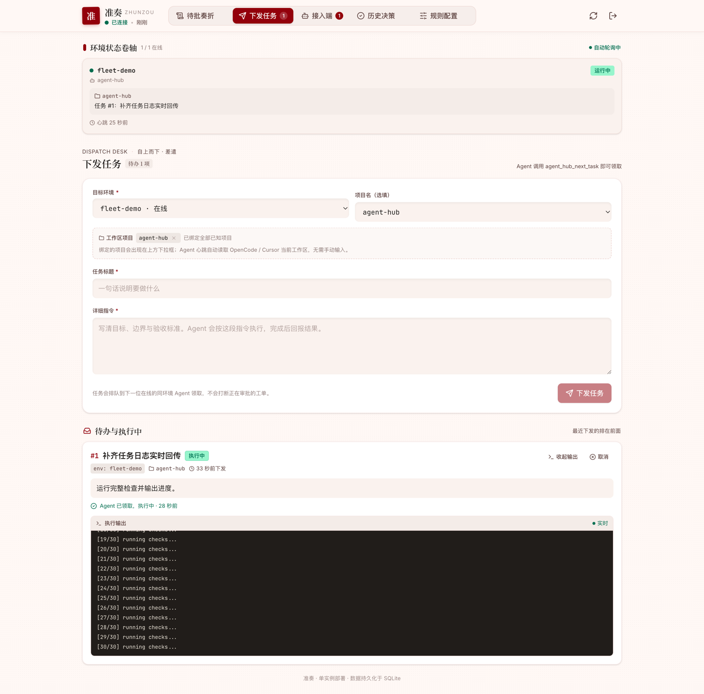
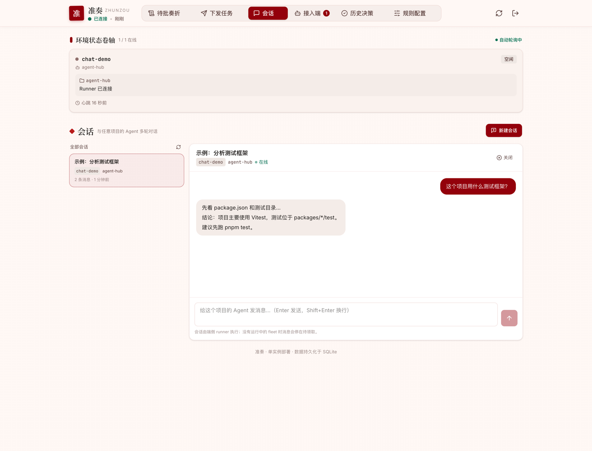

# 准奏（Zhunzou）

[English](./README.md) · 中文

> Agent 上奏，总管拟票，你一句「准奏」。

<p align="center">
  <a href="https://github.com/Asterune/ZhunZou/actions/workflows/ci.yml"></a>
  <a href="./LICENSE"></a>
  <a href="./package.json">= 20" /></a>
</p>

<p align="center">
  
</p>

跨设备多 Agent 异步决策中枢。端侧（Cursor / OpenCode / 任意 Agent）遇到需要人类拍板的卡点时，把问题压缩成「三行简报 + 结构化选项」提交到云端；总管 Agent 按《全局工程规范》自动处理大部分常规决策，剩余部分进入 Web 看板集中审批，端侧通过长轮询 / CLI 无感阻塞等待结果。

设计上刻意保持**通用、可插拔**：预审模型、通知渠道、端侧接入和自定义逻辑都可以替换，不绑定某一家模型或某一个 IDE。扩展方式见 [docs/PLUGINS.md](./docs/PLUGINS.md)。

## 它解决什么问题

AI Agent 写代码很快，但一到「需要人类拍板」就慢下来。现实中通常是这样丢时间的：

- **Agent 卡在你没看的地方。** 它停在你没盯着的终端或编辑器标签页里，任务一停就是几小时。
- **或者它先猜，你事后擦屁股。** 错误假设往往到 code review 甚至线上才被发现。
- **同一个问题反复问。** 决策只活在某个聊天记录里，换一个 Agent、换一周又要重新解释一遍。
- **每个工具各自为政。** Cursor 窗口、Claude Code 会话、CI 任务各有一套「等人」的方式，多仓多 Agent 团队没有统一队列。
- **自动化只有全有或全无。** 要么每个问题都卡住等人，要么开 YOLO 模式，把本该人工确认的高风险操作一起放过。

现有做法都不太解决这个问题：在聊天里问一句没有结构、没有超时、没有审计，也没法精准唤醒当初提问的那个 Agent；厂商自带的审批界面又通常只覆盖一个编辑器或一朵云。

## 准奏怎么做

把每一次「需要人拍板」变成一个结构化、可异步处理的小工单：

```text
Agent 遇到卡点
  → 提交「三行简报 + 2~6 个封闭选项（可标高危）」
  → 总管 Agent 按 GLOBAL_RULES.md 和历史判例预审
      → 常规决策：几秒内自动准奏
      → 其余情况：进入手机 / 桌面上的统一待批队列
  → 你点一下，长轮询立即唤醒正在等待的 Agent
  → 本次批复沉淀为候选规则，下次直接复用
```

不用轮询，不会丢上下文，也不需要一直把编辑器摆在面前。

## 为什么选准奏

- **是决策，不是聊天。** 工单被约束成「三行简报 + 封闭选项」，不会出现「你到底想问什么」的来回拉扯。
- **规则先行，人只在关键处出现。** 总管 Agent 按 `GLOBAL_RULES.md` 和历史判例处理常规问题，真正需要判断的才转人工。
- **一个入口管所有 Agent。** Cursor、OpenCode、Claude Code、Codex、Gemini、Windsurf，或任意 MCP 客户端；桌面、手机、通知里的签名链接都能批。统一队列，统一审计。
- **人不在也能推进。** 长轮询让你点完的瞬间 Agent 就恢复执行；编辑器关了，还有无头 `wake` / `fleet` 守护进程继续领任务。
- **默认安全。** 高危选项永不自动执行，超时裁决默认关闭；人工决定永远覆盖迟到的总管或超时结果。
- **判例复用，而不是重复回答。** 已解决的决策会被召回为判例，每次人工批复还能一键沉淀成规则。
- **部署极轻。** 一个 Node.js 进程、一个 SQLite 文件、一个端口；不需要 Redis、消息队列，端侧也没有原生编译步骤。
- **开源、可自托管。** MIT 协议，纯 HTTP API，模型、通知渠道、Agent 适配器都可替换，决策数据留在自己的服务器上。

**适合：** 你同时跑多个仓库 / 多个 IDE 的 AI Agent，已经被「等人拍板」拖成瓶颈，想要自动化但不想放弃控制权。

**不适合：** 只需要单用户、单会话的「是 / 否」确认，或者你想要的是一个完全自治的编码 Agent。

## 当前状态

当前状态：**M1–M13 全部完成**，具备共享协议、云端服务、长轮询、Meta-Agent、MCP/CLI 桥接、Web 看板、单端口部署、「历史判例 + 批复沉淀」的决策记忆闭环、超时裁决、批量审批、高风险保护、陈旧任务治理、通知内签名一键批复与接入向导，以及反向长连（M9）、交互式 PTY 终端与治理（M10–M12）、bridge WS 混合传输（M13）、可安装 PWA 看板与一键接入。里程碑表见 [PROJECT_PLAN.md](./PROJECT_PLAN.md)，尚未覆盖的部分见文末「后续可选增强」。

---

## 目录结构

```text
zhunzou/
├── package.json
├── pnpm-workspace.yaml
├── tsconfig.base.json
├── GLOBAL_RULES.md              # Meta-Agent 预审依据（可在线编辑）
├── .env.example
├── Dockerfile / docker-compose.yml
├── ecosystem.config.cjs         # pm2 单实例配置
├── docs/                        # PLUGINS.md / REALTIME.md / RELEASING.md / UI 说明
├── examples/plugins/            # 外部插件示例（审计日志 / 自定义通知）
├── scripts/
│   ├── smoke-test.sh            # 启动真实服务 + HTTP 冒烟测试
│   ├── bridge-smoke-test.sh     # 真实服务 + MCP stdio + CLI 端到端
│   ├── web-smoke-test.sh        # 构建产物 + 单端口看板托管验收
│   └── deploy-pm2.sh            # 一键构建并 (重) 启动 pm2
├── deploy/                      # 生产部署（systemd + nginx）
│   ├── deploy.sh                # 本地打包 → 上传 → 远程构建
│   ├── setup.sh                 # 服务器端安装 / systemd / nginx
│   ├── enable-https.sh          # Let's Encrypt 证书 + HTTPS
│   └── zhunzou.service / nginx.conf
├── release/bridge/              # standalone bridge 发布产物（对应 /releases/bridge/）
└── packages/
    ├── shared/                  # Zod Schema、TypeScript 类型、状态机常量
    ├── server/                  # Fastify API、SQLite/Drizzle、Meta-Agent、通知、插件、长轮询、WS 网关
    ├── bridge/                  # 端侧 MCP Server + CLI（init / wait / wake / fleet / service / upgrade）
    ├── web/                     # Vue 3 + Vite + TailwindCSS 批奏折看板（可安装 PWA）
    └── device/                  # 反向长连守护进程：在线状态、机器能力、node-pty 终端
```

---

## 快速开始

要求：Node.js >= 20、pnpm 9（可用 `corepack enable pnpm`）。

```bash
pnpm install
cp .env.example .env          # 填入 HUB_SECRET_TOKEN / OPENAI_API_KEY

pnpm build                    # 构建 shared / server / bridge / web
pnpm server                   # 默认 http://127.0.0.1:8787
```

浏览器打开 `http://127.0.0.1:8787`，输入 `HUB_SECRET_TOKEN` 即可进入批奏折看板。生产构建由 Fastify 同端口托管，无需额外 Web 服务器。

开发模式（服务端热重载 + Vite 前端代理）：

```bash
pnpm dev          # 服务端 :8787
pnpm dev:web      # 看板 :5173，/api 自动代理到 :8787
```

> 未配置 `OPENAI_API_KEY` 时，Meta-Agent 会自动跳过预审，所有工单直接转 `PENDING_HUMAN`，方便本地联调。

### 用 curl 走一遍完整流程

```bash
TOKEN=dev-token   # 与 .env 中的 HUB_SECRET_TOKEN 保持一致

# 1. 提交卡点工单
curl -s -X POST http://127.0.0.1:8787/api/tickets \
  -H "Authorization: Bearer $TOKEN" \
  -H 'Content-Type: application/json' \
  -d '{
    "env": "company-cursor",
    "projectName": "yikuaomed-erp",
    "doneSummary": "完成登录页表单校验",
    "blockerQuestion": "错误提示用 Toast 还是行内文案？",
    "nextStepPlan": "确定后接入统一错误处理并补测试",
    "options": [
      { "key": "A", "label": "Toast 提示", "prosCons": "统一、实现快" },
      { "key": "B", "label": "行内文案", "prosCons": "更贴近字段" }
    ],
    "recommendedOption": "A"
  }'

# 2. 端侧长轮询（会挂起最多 40s）
curl -s "http://127.0.0.1:8787/api/tickets/1/wait?timeout=40000" \
  -H "Authorization: Bearer $TOKEN"

# 3. 另一个终端：人类审批，长轮询立即被唤醒
curl -s -X POST http://127.0.0.1:8787/api/tickets/1/resolve \
  -H "Authorization: Bearer $TOKEN" \
  -H 'Content-Type: application/json' \
  -d '{"selectedOption":"B","customInstruction":"先只改登录页"}'
```

---

## Web 批奏折看板（M4）

单页 Vue 3 应用，默认由 Fastify 在同一个端口托管（`SERVE_WEB=true`），无需 CORS。

- **登录门**：粘贴 `HUB_SECRET_TOKEN`，仅存于本机 `localStorage`（`zhunzou.token`，自动兼容旧的 `agent-hub.token`）。
- **接入端状态栏**：展示每个 `env` 的在线心跳、Running / Blocked / Idle 状态与当前任务，90 秒无心跳自动置灰。
- **接入端管理**：把每个 `env` 当作可管理的 Agent——客户端类型、版本、主机、系统、当前项目、专属 Token 的签发/轮换/吊销，以及改名、停用、删除；顶部按 host 汇总运行节点（托管项目数、在线数、bridge 版本）。
- **任务实时输出**：任务卡展开即可看 `stdout` / `stderr` / 系统事件，执行中每 1.2 秒增量拉取；每个任务最多保留 256 KB，结束后仍可回看。
- **交互式会话**：在「会话」页直接和任意项目的 Agent 多轮对话；每条消息由端侧 runner 用可恢复 CLI（`--session` / `--resume`）执行，输出实时回传并保留上下文。
- **待批奏折**：`PENDING_META` / `PENDING_HUMAN` 工单按创建时间排队；卡片即三行简报（已完成 / 卡点 / 下一步），点击任一方案即提交审批，可附带补充指令。推荐方案会高亮，但不影响选择。
- **超时默认裁决**：开启 `AUTO_RESOLVE_TIMEOUT_MS` 后，待批卡片显示倒计时，到期按推荐方案自动准奏；可「暂缓 10 分钟」。推荐方案标记为 `destructive` 时永不自动执行。
- **批量准奏**：积压多封时一键按各自推荐方案批复，提交前有 3 秒撤销窗口；高风险方案默认跳过，需勾选后才会一并批准。
- **高风险保护**：选项支持 `risk: safe | caution | destructive`；破坏性选项必须人类二次确认，Meta-Agent 与超时策略都不能自动通过。
- **通知内一键批复**：设置 `PUBLIC_BASE_URL` 后，Bark / 飞书 / Slack / Discord / ntfy / Telegram / Webhook 的通知都会带签名审批链接；手机点开即可选方案提交，无需登录看板。链接绑定单张工单、默认 30 分钟过期，重复提交会被状态机拒绝。
- **下发任务**：人 → Agent 的反向调度。在看板指定环境、项目、标题与详细指令，端侧 Agent 通过 `agent_hub_next_task` 领取并执行，完成后回报结果；看板状态栏同步显示真实任务。
- **工作区项目绑定**：每个环境（工作区）可绑定多个项目，下发任务时「项目名」下拉框只列出该环境已绑定的项目，不用再手输。Agent 心跳会自动上报 OpenCode / Cursor 当前打开的工作区（git 根目录名），服务端据此自动绑定；也可在看板用下拉框绑定其他已上报项目 / 解除（当前活跃项目不可解除，心跳会自动恢复）。
- **历史决策**：自动放行与人工审批的完整记录，含决定、理由与补充指令。
- **规则配置**：在线编辑 `GLOBAL_RULES.md`，保存后 Meta-Agent 立即使用新规则，无需重启。
- **批复沉淀**：每次人工审批后自动提炼一条候选规则；在规则页一键采纳后并入 `GLOBAL_RULES.md`，也可忽略。没有配置 LLM 时使用确定性模板，功能仍可用。
- **决策记忆**：Meta-Agent 预审时会参考同项目最近的历史判例，优先保持决策一致性，并在理由中注明「沿用 #编号」。
- **可安装 PWA**：带 `manifest.webmanifest` 与 Service Worker，可在桌面 / 手机浏览器「添加到主屏幕」后以独立窗口运行；页面导航走 network-first，构建产物走 stale-while-revalidate，断网时展示离线提示页（`/offline.html`）。新版本会在应用内弹窗提示，可选择「立即更新」或「之后更新」；Service Worker 仅在构建产物中注册，开发模式不受影响。
- **实时同步**：`/ws/realtime` 推送 `sync.snapshot` / `sync.changed`，WS 在线时暂停 HTTP 长轮询；断线自动回退到 `/api/sync`，页面隐藏/恢复仍生效。

前端源码位于 `packages/web`，使用 `createHubStore` 组合式状态管理（未引入 Pinia），TailwindCSS 4 + Vite 8 构建。

---

## 跨设备反向长连（device daemon）

MCP bridge 仍是 HTTP 长轮询；如果希望中心主动保持到每台机器的反向连接，在端侧额外运行 device daemon：

```bash
pnpm --filter @zhunzou/device build

node packages/device/bin/device.js run \
  --hub https://hub.example.com \
  --token zz_xxx \
  --env home-mac \
  --project agent-hub \
  --heartbeat 30000

# 查看本机能力：OS、负载、CLI 清单、PTY 支持
node packages/device/bin/device.js capabilities --json   # 子命令别名：print
```

`run` 是默认子命令。`--token` 依次回退 `ZHUNZOU_DEVICE_TOKEN` → `HUB_TOKEN` → `HUB_SECRET_TOKEN`，`--hub` 回退 `ZHUNZOU_HUB_URL` → `HUB_URL`，`--env` 回退 `ZHUNZOU_DEVICE_ENV` → `AGENT_ENV`（默认 `device-<hostname>`）；重连退避用 `ZHUNZOU_RECONNECT_MIN_MS` / `ZHUNZOU_RECONNECT_MAX_MS`。

daemon 主动连接 `wss://<hub>/ws/device`，发送 `hello` 上报协议版本、OS/架构/主机名/shell、PTY 后端、CPU/内存/负载与本地 CLI 清单（claude、cursor-agent、agent、opencode、codex、gemini、aider、goose、amp、git、node、pnpm、docker、tmux 等），之后按服务端下发的间隔（默认 30 秒）心跳。看板「接入端」页会显示反向长连徽标、CPU/负载/内存与可用 CLI；断开后立即标记离线。帧级细节见 [docs/REALTIME.md](./docs/REALTIME.md)。

- 设备端使用专属 Agent Token（`zz_...`）或管理员 Token；浏览器看板先调用 `POST /api/realtime/ticket` 换取 60 秒短期 ticket，再连接 `/ws/realtime`。
- `REALTIME_ENABLED=false` 可关闭 WS 网关，完全回退到原有 HTTP 心跳 / 长轮询。
- `node-pty` 是可选依赖：只上报在线状态的设备不装它也能跑，`capabilities` 会显示 `pty: unavailable`；装上后即提供下一节的交互式终端。

---

## 远程交互式终端（PTY）

device daemon 也可以托管真正的 PTY shell（macOS forkpty、Windows ConPTY）。`node-pty` 是可选依赖，按需安装：

```bash
pnpm --filter @zhunzou/device add node-pty
```

启动 daemon 后，看板「终端」页可以：

- 选择在线设备、项目、shell，新建终端；
- 使用 xterm.js 直接输入/输出，ANSI 颜色与光标行为完整；
- 浏览器刷新后按 seq 重放最近 scrollback；
- 设备 WS 断线后 `pty.attach` 重挂同一 shell；
- 服务端重启后从 SQLite 恢复会话元数据，设备进程还在则自动重挂，否则标记 `LOST`。

```text
浏览器 xterm ──/ws/terminal──▶ 中心 ──/ws/device──▶ node-pty (ConPTY/forkpty)
```

安全与限额：`TERMINAL_ENABLED`、`TERMINAL_MAX_SESSIONS`、
`TERMINAL_MAX_SESSIONS_PER_DEVICE`、`TERMINAL_MAX_VIEWERS`、
`TERMINAL_IDLE_TIMEOUT_MS`、`TERMINAL_DETACH_TTL_MS`、
`TERMINAL_SCROLLBACK_BYTES`、`TERMINAL_INPUT_BYTES_PER_SEC`、
`TERMINAL_ALLOWED_ENVS`。同一终端同一时刻只有一个窗口持有输入权，其他窗口显示
「只读」并可点「接管输入」；输入、resize、信号、接管与关闭都会写入
`terminal_audit`，可通过 `/api/terminals/:id/audit` 查看，并支持导出 CSV / JSONL。
接入端页还可以单独「禁用终端」，禁用后新终端请求返回 `TERMINAL_FORBIDDEN`。

---

## API

除 `GET /healthz` 与签名审批页 `/a/:token` 外，所有接口都需要 `Authorization: Bearer <token>`。
Token 分两种：`HUB_SECRET_TOKEN`（管理员，拥有全部权限）和看板「接入端」页签发的专属 Agent Token
（只能操作自己的 `env`）。服务端未配置专属 Token 时，继续用管理员 Token 也完全兼容。
错误统一返回 `{ "error": { "code": "...", "message": "...", "details"?: ... } }`。

| 方法 | 路径 | 说明 |
| --- | --- | --- |
| `GET` | `/healthz` | 健康检查（免鉴权） |
| `GET` | `/a/:token` | 签名审批页（免 Bearer，链接自带能力与有效期） |
| `POST` | `/a/:token/resolve` | 从签名审批页提交决定 |
| `GET` | `/install.sh` · `/install.ps1` | 服务端渲染的一键安装脚本（`?code=ABCDE-FGHIJ`，免鉴权） |
| `POST` | `/api/enroll` | 接入码换取专属 Agent Token（免鉴权，码本身是能力凭证） |
| `GET` | `/api/bridge/latest` | standalone bridge 发布清单，供 `upgrade` / 自更新使用（免鉴权） |
| `POST` | `/api/tickets` | 创建工单，返回 `201`，随后异步触发 Meta-Agent 预审 |
| `POST` | `/api/decisions` | 统一裁决入口：`{ kind, proposal, context?, risk?, options? }` → `APPROVED` 或 `PENDING` 工单 |
| `GET` | `/api/tickets/:id` | 查询单个工单 |
| `GET` | `/api/tickets` | 列表，支持 `?status=&projectName=&env=&limit=` |
| `GET` | `/api/tickets/:id/wait?timeout=40000` | 长轮询；返回 `{ resolved, timedOut, ticket }` |
| `POST` | `/api/tickets/:id/resolve` | 人工审批 `{ selectedOption, customInstruction?, confirmDestructive? }` |
| `POST` | `/api/tickets/batch-resolve` | 批量审批 `{ ticketIds, selectedOption?, confirmDestructive? }` |
| `POST` | `/api/tickets/:id/extend` | 暂缓自动裁决 `{ minutes? }`，默认 10 分钟 |
| `POST` | `/api/tickets/:id/cancel` | 取消仍在等待的工单 |
| `POST` | `/api/tasks` | 人 → Agent 下发任务 `{ env, title, instruction, projectName? }` |
| `GET` | `/api/tasks` | 任务列表，支持 `?env=&status=&limit=` |
| `GET` | `/api/tasks/next?env=...&timeout=40000` | 端侧长轮询领取任务；无任务时超时返回 |
| `POST` | `/api/tasks/:id/complete` | Agent 回报完成 / 失败 `{ status, result? }` |
| `POST` | `/api/tasks/:id/release` | 端侧唤不醒 Agent 时交回任务 `{ requeue?, reason? }`，重新排队而不是卡在 `CLAIMED` |
| `POST` | `/api/tasks/:id/log` | Agent 追加执行输出 `{ stream: stdout / stderr / system, chunk }` |
| `GET` | `/api/tasks/:id/logs` | 增量读取执行输出 `?after=<id>&limit=` |
| `POST` | `/api/sessions` | 新建会话 `{ env, projectName?, title? }` |
| `GET` | `/api/sessions` | 会话列表，支持 `?env=&limit=` |
| `GET` | `/api/sessions/:id` | 会话详情与消息 |
| `POST` | `/api/sessions/:id/messages` | 发送用户消息 `{ content }` |
| `POST` | `/api/sessions/proposals` | Agent 起草下一句回复 `{ env, sessionId?, content, rationale? }`，存为 `PROPOSED` |
| `POST` | `/api/sessions/:id/proposals/:messageId/adopt` | 采纳草稿（可带改写后的 `content`）并排队发送 |
| `POST` | `/api/sessions/:id/proposals/:messageId/discard` | 丢弃草稿（保留记录用于审计） |
| `POST` | `/api/sessions/:id/close` | 关闭会话 |
| `DELETE` | `/api/sessions/:id` | 删除会话（连带消息与输出记录，不可恢复） |
| `GET` | `/api/sessions/next?env=...&timeout=40000` | 端侧长轮询领取待处理消息 |
| `POST` | `/api/sessions/:id/messages/:messageId/events` | Agent 追加输出 `{ stream, chunk }` |
| `GET` | `/api/sessions/:id/events` | 增量读取会话输出 `?after=&messageId=` |
| `POST` | `/api/sessions/:id/messages/:messageId/complete` | 回报结果 `{ status, content?, externalId?, error? }` |
| `POST` | `/api/sessions/:id/messages/:messageId/retry` | 重试失败的轮次（重置为待领取） |
| `POST` | `/api/exchanges` | Agent 镜像本轮问答 `{ env, question?, conclusion?, projectName? }`（后两者至少填一项） |
| `GET` | `/api/exchanges` | 会话镜像列表，支持 `?env=&projectName=&limit=` |
| `POST` | `/api/tasks/:id/cancel` | 人取消尚未结束的任务 |
| `GET` | `/api/workspace-projects` | 工作区项目绑定列表，支持 `?env=` |
| `POST` | `/api/workspace-projects` | 绑定项目 `{ env, projectName }`，幂等 |
| `DELETE` | `/api/workspace-projects/:id` | 解除一条工作区项目绑定 |
| `POST` | `/api/fleet/candidates` | bridge 上报本机可关联目录（按 host 覆盖） |
| `GET` | `/api/fleet/candidates` | 可关联目录列表，支持 `?host=` |
| `POST` | `/api/fleet/workspaces` | 从候选目录创建关联 `{ candidateId }` |
| `GET` | `/api/fleet/workspaces` | 关联任务列表，支持 `?host=` |
| `DELETE` | `/api/fleet/workspaces/:id` | 解除目录关联 |
| `POST` | `/api/fleet/workspaces/:id/retry` | 重试失败的关联 |
| `GET` | `/api/fleet/desired` | bridge 拉取本机待关联目录（含一次性 Token）与目录浏览请求 |
| `POST` | `/api/fleet/desired/:id/status` | bridge 回报 `APPLIED` / `FAILED` |
| `POST` | `/api/fleet/browse` | 请求 bridge 列出目录 `{ host, path? }` |
| `GET` | `/api/fleet/browse/:id` | 读取目录浏览结果 |
| `POST` | `/api/fleet/browse/:id/result` | bridge 回报目录列表 |
| `POST` | `/api/status/heartbeat` | 端侧上报 `{ env, status, projectName?, currentTask?, agent? }`，同时续租该端执行中的任务 |
| `GET` | `/api/status` | 各接入端在线状态（90s 内有心跳视为在线） |
| `GET` | `/api/sync` | 看板整表快照长轮询（`rev` / `changed`）；`/ws/realtime` 可用时自动暂停 |
| `POST` | `/api/realtime/ticket` | 管理员 Token 换取短期看板 WebSocket ticket |
| `GET` | `/api/realtime/status` | 实时网关状态（设备 / 看板 / bridge 连接数） |
| `POST` | `/api/terminals` | 在在线设备上创建 PTY 终端 |
| `GET` | `/api/terminals` | 终端会话列表（`env`、`status`、`limit`） |
| `GET` | `/api/terminals/:id` | 单个终端会话 |
| `POST` | `/api/terminals/:id/close` | 关闭终端并终止 shell |
| `GET` | `/api/terminals/:id/events?after=` | 有界 scrollback 回放 |
| `GET` | `/api/terminals/:id/audit?after=` | 终端审计（输入/接管/resize/信号/关闭） |
| `GET` | `/api/terminals/:id/audit/export?format=csv` | 导出审计为 CSV / JSONL |
| `GET` | `/api/terminals/stats` | 终端指标（活跃数/窗口数/字节数） |
| `GET` | `/api/agents` | 接入端列表，支持 `?status=active` / `disabled` |
| `POST` | `/api/agents` | 手动登记接入端 `{ env, name?, kind? }` |
| `PATCH` | `/api/agents/:env` | 改名 / 改类型 / 停用 `{ name?, kind?, status? }` |
| `DELETE` | `/api/agents/:env` | 删除接入端（历史工单保留；心跳/在线状态一并清除，在线连接立即断开） |
| `POST` | `/api/agents/:env/token` | 签发或轮换专属 Token，明文只返回一次 |
| `DELETE` | `/api/agents/:env/token` | 吊销专属 Token |
| `POST` | `/api/enrollments` | 生成一次性接入码与安装命令（默认 15 分钟有效、最多 10 个客户端） |
| `GET` | `/api/resume?env=...&since=...` | 端侧重启恢复：未决/近期工单 + 活跃任务 |
| `GET` | `/api/rules` | 读取 `GLOBAL_RULES.md` |
| `PUT` | `/api/rules` | 在线更新规则 `{ content }` |
| `GET` | `/api/rules/candidates` | 候选规则列表，`?status=` 取 `PENDING` / `ACCEPTED` / `DISMISSED`，支持 `&limit=` |
| `POST` | `/api/rules/candidates/:id/accept` | 采纳候选规则并追加到 `GLOBAL_RULES.md` |
| `POST` | `/api/rules/candidates/:id/dismiss` | 忽略候选规则 |

### WebSocket 端点

仅在 `REALTIME_ENABLED=true` 时启用；关闭后上面的 HTTP 路径原样可用。

| 路径 | 方向 | 用途与鉴权 |
| --- | --- | --- |
| `/ws/device` | 设备 → 中心 | 反向长连：`hello` + `heartbeat` + `pty.*`。管理员 Token（带 `?env=`）或设备专属 Token，走 Bearer 头或 `?token=` |
| `/ws/bridge` | bridge → 中心 | 任务 / 工单 / 会话领取（`task.claim` / `ticket.wait` / `chat.claim`），对应 `ZHUNZOU_TRANSPORT=auto` |
| `/ws/realtime` | 中心 → 浏览器 | 看板推送 `sync.snapshot` / `sync.changed`；需要 `POST /api/realtime/ticket` 换来的 `?ticket=`，或管理员 Bearer |
| `/ws/terminal` | 浏览器 ↔ 中心 | 一个 PTY 会话：`?ticket=&sessionId=&afterSeq=` 回放 scrollback，输入 / resize / 接管 / 关闭都会审计 |

未知 WS 路径直接以 `401` / `404` 拒绝。

### 长轮询约定

- 单次请求最长 55s（`MAX_WAIT_TIMEOUT_MS`），默认 40s，可用 `WAIT_TIMEOUT_MS` 调整。
- 已 resolved / cancelled 的工单会**立即**返回，不占用等待时间。
- 唤醒完全走内存 `EventEmitter`，等待期间**不会轮询数据库**；SQLite 只负责持久化。
- 超时返回 `{ resolved: false, timedOut: true, ticket }`，客户端可据此重试。

### 工单状态机

```text
POST /tickets
      │
      ▼
PENDING_META ──(规范覆盖，自动拍板)──▶ AUTO_RESOLVED
      │
      └──(需人工 / 预审失败 / 未配置 LLM)──▶ PENDING_HUMAN ──(看板审批)──▶ HUMAN_RESOLVED
      │
      └──(端侧取消)──▶ CANCELLED
```

人工决定永远优先：即使 Meta-Agent 的回复迟到，也不会覆盖已完成的 `HUMAN_RESOLVED`（数据库条件更新保证）。

### 任务状态机（人 → Agent）

```text
POST /api/tasks
      │
      ▼
PENDING ──(agent_hub_next_task 领取)──▶ CLAIMED ──(agent_hub_complete_task)──▶ DONE / FAILED
   │                                        │
   └──────────────(看板取消)────────────────┴──▶ CANCELLED
```

- 任务按 `env` 隔离：只有同一 `AGENT_ENV` 的桥接能领取。
- 领取是条件更新，两个 Agent 同时轮询也只有一个能拿到同一条任务。
- 每次领取会累加 `attempts`。如果端侧离线超过 `TASK_CLAIM_TIMEOUT_MS`，任务自动放回 `PENDING`；
  超过 `TASK_MAX_ATTEMPTS` 或 `TASK_HARD_TIMEOUT_MS` 后标记 `FAILED`，不会永久卡在 `CLAIMED`。
- `GET /api/tasks/next` 使用与审批相同的进程内 `EventEmitter` 唤醒，单实例部署约束不变。

---

## Meta-Agent 预审（可插拔）

预审策略由 `META_AGENT_PROVIDER` 选择，核心只依赖一个 `MetaAgent` 接口：

| Provider | 行为 |
| --- | --- |
| `openai`（默认） | 调用任意 OpenAI 兼容的 `/chat/completions`（DeepSeek / OpenAI / Moonshot / Ollama / vLLM…） |
| `http` | 把 `{ ticket, rules }` POST 到 `META_AGENT_ENDPOINT`，由你自己的服务返回裁决 |
| `none` | 关闭预审，所有工单直接转人工 |

OpenAI 兼容模式的流程：

1. 读取 `GLOBAL_RULES.md`；
2. 将「规则 + 工单三点简报 + 选项」发送给模型；
3. 强制返回严格 JSON：`{ "canResolve": boolean, "selectedOption": "A", "reason": "..." }`；
4. 模型给出的选项必须真实存在于工单中，否则自动降级为人工审批；
5. `canResolve === false` 时按 `NOTIFY_CHANNELS` 并行通知（Bark / 飞书 / Slack / Discord / ntfy / Telegram / Webhook）。

预审前会从同一项目召回最近的历史已决工单（字符 bigram 相似度，零外部依赖），作为
「历史判例」注入 prompt，帮助 Meta-Agent 对同类问题保持一致判断。历史判例只是参考，
不会覆盖规范，也不会让高风险变更自动通过。

人工审批完成后，服务端会在后台把这次批复提炼成一条候选规则（有 LLM 时用 LLM 抽象，
没有 LLM 时用确定性模板），进入规则页的「御前待议」列表；采纳后追加到
`GLOBAL_RULES.md` 的 `## 历史批复沉淀` 小节，忽略则只保留审计记录。

`META_AGENT_HEADERS` 可以追加任意请求头，适配带网关鉴权的部署。

规则文件可通过 `PUT /api/rules` 在线维护，无需重启服务。建议把团队真实偏好写具体，例如：

- 非破坏性重构一律采纳推荐方案；
- 数据库 schema / API 契约变更必须人工确认；
- 前端状态管理统一 Pinia。

### 统一裁决入口：决策权在 hub

`POST /api/decisions`（MCP 工具 `agent_hub_decide`）是唯一入口。Agent 不再自己判断
「这件事该不该问人」，而是提交**它打算原样执行的提案**加事实，由 hub 用同一套
`GLOBAL_RULES` + 历史判例 + destructive 硬拦截来裁决：

| 输入 | 说明 |
| --- | --- |
| `kind` | `reply`（会话回复）/ `next_step`（下一步动作）/ `action`（具体操作） |
| `proposal` | 原样要执行的回复文本或动作，hub 就按这句裁决 |
| `context` | 事实：测试输出、diff 摘要、约束条件 |
| `risk` | `safe` / `caution` / `destructive`；`destructive` 永远转人工 |
| `options` + `recommendedOption` | 仅在确实需要人多选一时提供 |

返回只有两种结果：

- `APPROVED`：放行；`kind=reply` 时回复已自动排队，端侧立刻领取；
- `PENDING`：同一份提案变成待批奏折，Agent 继续长轮询等人类拍板。

`DECISION_POLICY` 控制 hub 的权限边界：`off` 全问人、`reply` 只自动裁决会话回复、
`all` 连下一步动作也裁决。默认 `reply`，即「说话可以自动、动代码必须问人」。

### 通知渠道

`NOTIFY_CHANNELS` 逗号分隔、并行 fan-out；不配置时保持旧行为（有 `WEBHOOK_URL` 就用通用 Webhook）：

```bash
NOTIFY_CHANNELS=bark,feishu,console
```

所有渠道单次超时 5 秒，失败只记日志，不影响工单与长轮询。

设置 `PUBLIC_BASE_URL=https://hub.example.com` 后，通知正文会列出全部选项并附带签名审批链接
（`/a/:token`）。手机点开即可直接选择方案提交，不需要登录看板；链接默认 30 分钟过期，
只对一张工单有效，高风险选项仍需勾选确认。Bark 会把链接作为点击跳转，ntfy 使用 `Click` 头。

### 外部插件

`HUB_PLUGINS` 可加载任意 ES Module，挂载工单生命周期钩子：

```bash
HUB_PLUGINS=./examples/plugins/audit-log.mjs
```

支持 `onTicketCreated` / `onTicketPendingHuman` / `onTicketResolved` /
`onTicketCancelled` / `onReady` / `onClose`。完整接口、通知渠道变量和示例见
[docs/PLUGINS.md](./docs/PLUGINS.md)。

---

## 配置

复制 `.env.example` 为 `.env`。常用变量：

| 变量 | 默认值 | 说明 |
| --- | --- | --- |
| `NODE_ENV` | `development` | `production` 要求显式设置 `HUB_SECRET_TOKEN`，并把默认日志级别调到 `info` |
| `PORT` / `HOST` | `8787` / `0.0.0.0` | 监听地址 |
| `LOG_LEVEL` | dev `debug` / prod `info` | Pino 日志级别 |
| `HUB_SECRET_TOKEN` | 开发环境 `dev-token` | 生产环境必须显式设置 |
| `DATABASE_PATH` | `./data/zhunzou.db` | SQLite 文件路径 |
| `GLOBAL_RULES_PATH` | `./GLOBAL_RULES.md` | 规则文件路径 |
| `META_AGENT_ENABLED` | `true` | `false` 等同 `META_AGENT_PROVIDER=none` |
| `META_AGENT_PROVIDER` | `openai` | `openai` / `http` / `none` |
| `OPENAI_BASE_URL` | `https://api.deepseek.com/v1` | OpenAI 兼容接口 |
| `OPENAI_API_KEY` | 空 | 为空时跳过自动预审 |
| `META_AGENT_MODEL` | `deepseek-chat` | 预审模型 |
| `DECISION_POLICY` | `reply` | 裁决权归属：`off` 全部问人 / `reply` 只自动裁决会话回复 / `all` 连下一步动作也由 hub 裁决（destructive 永远问人） |
| `META_AGENT_ENDPOINT` | 空 | `provider=http` 时的决策服务地址 |
| `META_AGENT_HEADERS` | 空 | 额外请求头（JSON） |
| `META_AGENT_TIMEOUT_MS` | `15000` | LLM 请求超时 |
| `NOTIFY_CHANNELS` | 空 | `webhook,bark,feishu,slack,discord,ntfy,telegram,console` |
| `WEBHOOK_URL` / `WEBHOOK_SECRET` | 空 | 通用通知 Webhook（兼容旧配置） |
| `BARK_KEY` / `BARK_URL` | 空 | Bark（iOS）；只给 KEY 时自动拼 `https://api.day.app/<key>` |
| `FEISHU_WEBHOOK_URL` · `SLACK_WEBHOOK_URL` · `DISCORD_WEBHOOK_URL` | 空 | 各 IM 的 incoming webhook |
| `NTFY_URL` / `NTFY_TOKEN` | 空 | ntfy 主题与访问 Token |
| `TELEGRAM_BOT_TOKEN` / `TELEGRAM_CHAT_ID` | 空 | Telegram Bot 发送 |
| `HUB_PLUGINS` | 空 | 逗号分隔的插件模块路径 |
| `WAIT_TIMEOUT_MS` | `40000` | 默认长轮询窗口 |
| `AUTO_RESOLVE_TIMEOUT_MS` | `0` | 超时默认裁决时限；`0` 关闭。到期按推荐方案自动准奏 |
| `AUTO_RESOLVE_PROJECTS` | 空 | 允许自动裁决的项目，逗号分隔；空表示全部 |
| `SWEEP_INTERVAL_MS` | `5000` | 超时与陈旧任务清理的扫描间隔 |
| `TASK_CLAIM_TIMEOUT_MS` | `1800000` | 端侧离线超过该时长后，`CLAIMED` 任务自动重新排队 |
| `TASK_HARD_TIMEOUT_MS` | `21600000` | `CLAIMED` 任务硬超时，即使端侧在线也标记失败 |
| `TASK_MAX_ATTEMPTS` | `3` | 任务最多被领取次数，超过后标记 `FAILED` |
| `CHAT_MESSAGE_TIMEOUT_MS` | `300000` | 会话轮次 `RUNNING` 且该端离线超过此时长后判定失败；`0` 关闭恢复 |
| `PUBLIC_BASE_URL` | 空 | 通知里签名审批链接的公开地址，如 `https://hub.example.com` |
| `APPROVAL_LINK_SECRET` | `HUB_SECRET_TOKEN` | 审批链接 HMAC 密钥 |
| `APPROVAL_LINK_TTL_MS` | `1800000` | 审批链接有效期 |
| `REALTIME_ENABLED` | `true` | 是否启用设备 / 看板 WebSocket 网关 |
| `REALTIME_TICKET_TTL_MS` | `60000` | 浏览器 WebSocket ticket 有效期 |
| `REALTIME_HEARTBEAT_MS` | `30000` | 设备心跳间隔 |
| `REALTIME_HEARTBEAT_TIMEOUT_MS` | `90000` | 设备静默多久后关闭连接 |
| `TERMINAL_ENABLED` | `true` | 是否启用交互式 PTY 终端 |
| `TERMINAL_MAX_SESSIONS` | `32` | 全局终端会话上限 |
| `TERMINAL_MAX_SESSIONS_PER_DEVICE` | `4` | 每台设备的终端会话上限 |
| `TERMINAL_IDLE_TIMEOUT_MS` | `1800000` | 终端空闲多久后自动关闭 |
| `TERMINAL_DETACH_TTL_MS` | `300000` | 设备断线后保留会话的时长 |
| `TERMINAL_SCROLLBACK_BYTES` | `1048576` | 每个终端的回放缓冲大小 |
| `TERMINAL_MAX_VIEWERS` | `8` | 单个终端的并发浏览器窗口上限 |
| `TERMINAL_INPUT_BYTES_PER_SEC` | `65536` | 单个终端的输入速率上限 |
| `TERMINAL_ALLOWED_ENVS` | 空 | 允许开终端的设备 env；空表示全部 |
| `SERVE_WEB` | `true` | 是否由 Fastify 托管 `packages/web/dist` |
| `WEB_DIST_PATH` | `./packages/web/dist` | 前端构建产物目录 |
| `BRIDGE_RELEASES_PATH` | `./release/bridge` | standalone bridge 发布目录，公开托管在 `/releases/bridge/`，清单在 `/api/bridge/latest` |

相对路径统一以仓库根目录为基准解析，因此从任意目录启动都不会写错位置。

---

## 端侧接入

> **关于 `zhunzou-bridge` 命令的从哪来。** 分发渠道是你自己的 hub：一键安装会把校验过 SHA256 的
> standalone bundle 下载到 `~/.zhunzou/`，`upgrade` 负责后续自更新。`npx -y zhunzou-bridge` 要等
> 包正式发布到 npm 才能用；在那之前，请从仓库运行（`pnpm build && node packages/bridge/bin/cli.js …`），
> 或在一台已装好的机器上运行 `node ~/.zhunzou/cli.mjs …`。下文示例里的 `zhunzou-bridge …` 都按此替换。

### 命令一览

| 命令 | 作用 |
| --- | --- |
| `init` | 检测编辑器、写 MCP 配置与决策规则、签发专属 Token、校验连通性 |
| `wait --ticket 104 [--interval 15000]` | 阻塞等待该工单裁决，把决定打印到 stdout |
| `wake` | 长轮询领取下发任务并唤醒本机 Agent（`--adapter --command --cwd --args --poll --run-timeout --once`） |
| `fleet` | 一个进程跑多个项目的 wake 循环（`--config --once --refresh-tokens --print-launchd --no-auto-discover`） |
| `fleet add` · `scan` · `list` · `remove` | 维护 `~/.zhunzou/fleet.json` 里的项目 |
| `service`（`install` / `uninstall` / `status` / `restart`） | 管理登录自启的常驻服务 |
| `upgrade`（`--check` / `--force` / `--rollback`） | 从 hub 拉取最新 bridge 并切换版本指针 |

`wake` 适配器：`auto` / `opencode` / `opencode-run` / `claude` / `codex` / `gemini` / `cursor-agent` / `aider` / `goose` / `amp` / `command`（自定义命令模板）/ `notify`（只把任务显示在看板，不跑 CLI）。`auto` 优先接管已运行的 OpenCode 服务，其次按 `claude` → `codex` → `gemini` → `cursor-agent` → `aider` → `goose` → `amp` 探测，最后回退 `notify`。交互式会话需要可续跑的适配器：`opencode` / `opencode-run` / `cursor-agent` / `claude` / `command`。

### 一键接入（推荐给普通用户）

看板打开「接入端 → 一键接入」，填一个可选的环境名，点「生成接入命令」。把生成的其中一条命令发给目标电脑：

```bash
# macOS / Linux
curl -fsSL 'https://hub.example.com/install.sh?code=ABCDE-FGHIJ' | bash
```

```powershell
# Windows PowerShell
irm 'https://hub.example.com/install.ps1?code=ABCDE-FGHIJ' | iex
```

这条命令会自动完成：准备 Node 20+（没装 Node 时下载便携运行时并校验 SHA256）、从 hub 拉取对应版本的 bridge、用接入码为**每个客户端**换取专属 scoped Token、写入用户级 Cursor / OpenCode / Claude Code / Codex 配置、安装登录自启守护进程。用户不需要管理员 `HUB_SECRET_TOKEN`，也不需要克隆仓库。

接入码默认 15 分钟有效，最多可在**同一台电脑**上兑换 10 次（一次安装会为 4 个客户端各兑换一次）；第一次兑换会把接入码绑定到该主机，换台电脑无法复用。设备上线后会自动出现在「接入端」页。想跳过常驻服务、只在编辑器打开时在线：

```bash
curl -fsSL 'https://hub.example.com/install.sh?code=ABCDE-FGHIJ' | bash -s -- --no-service
```

```powershell
# irm | iex 无法传参数；存下来再跑即可传 -NoService / -Code / -HubUrl
iwr 'https://hub.example.com/install.ps1?code=ABCDE-FGHIJ' -OutFile install.ps1
.\install.ps1 -NoService          # 也可用 $env:ZHUNZOU_ENROLL_CODE / ZHUNZOU_HUB_URL
```

### 一台电脑，多个客户端

`init --target all` 不再让所有客户端共用一个 `AGENT_ENV`，而是各自派生独立身份：

| 客户端 | 环境（AGENT_ENV） | 客户端类型 |
| --- | --- | --- |
| Cursor | `cursor-<项目或主机名>` | `cursor` |
| OpenCode | `opencode-<项目或主机名>` | `opencode` |
| Claude Code | `claude-<项目或主机名>` | `claude-code` |
| Codex | `codex-<项目或主机名>` | `codex` |

每个 env 有自己的 Token 和看板卡片，心跳不再互相覆盖；同一个项目可以被多个 env 绑定。常驻服务会自动改用 `fleet` 守护这几个 env（`~/.zhunzou/fleet.json`）。

想回到「一个 env 写进所有客户端」的旧行为，显式传 `--env` 或 `--agent-kind` 即可。

生成接入码时把「环境标识」留空，各客户端会按 `<kind>-<项目或主机>` 自动命名；若填了环境名（例如「公司」），每个客户端会得到 `公司-cursor`、`公司-opencode`、`公司-claude`、`公司-codex`，同一客户端重跑会复用原卡而不会产生 `-2`。

Codex 只读用户级配置 `$CODEX_HOME/config.toml`（默认 `~/.codex/config.toml`），`init` 会写入或替换其中的 `[mcp_servers.zhunzou]` 段，不影响其它 server。

不想打开编辑器、但要让某个项目常驻在线时，用 `fleet` 把目录登记进来即可（不需要懂 JSON）：

```bash
npx zhunzou-bridge fleet add D:\work\erp D:\work\crm --code ABCDE-FGHIJ
npx zhunzou-bridge fleet list                          # 查看 env / 目录 / 项目 / Token
npx zhunzou-bridge fleet remove cursor-erp             # 按 env 移除

# 不想手敲路径：扫描本机 Cursor 最近打开的工作区
npx zhunzou-bridge fleet scan
npx zhunzou-bridge fleet scan --add --code ABCDE-FGHIJ # 全部登记（VS Code 加 --client code）

# 按目录扫描 git 仓库：--depth 2 表示向下两层（root 的子目录 + 孙目录）
npx zhunzou-bridge fleet scan --root ~/code --depth 2
npx zhunzou-bridge fleet scan --root ~/code --root ~/work --depth 2 --add --code ABCDE-FGHIJ
```

`fleet add` 会自动推断项目名（git 根目录）、写 `~/.zhunzou/fleet.json`；带 `--code` 时用看板接入码为每个项目签发 scoped Token（不需要管理员 Token），也可以用 `--admin-token` 或 `--token`。已经安装常驻服务的话会自动切到 `fleet` 模式并重启，让新项目立刻可被下发任务。

如果不想每次手动登记，可在 `~/.zhunzou/fleet.json` 里加一段 `scan`，`fleet` 每次启动都会自动扫描并纳入新仓库（不会写回配置文件）：

```json
{
  "scan": { "roots": ["~/code", "~/work"], "depth": 2 },
  "projects": []
}
```

自动发现的项目同样会按 `env 前缀-项目名` 命名；同名目录会用 `-2`、`-3` 区分。Token 走 `adminToken` / 缓存的 `fleet-tokens.json`，首次启动前请确保配置了其中一种。

连 `scan` 都不想配也可以：`fleet` 启动时如果配置里没有 `scan`，会自动纳入最近在 Cursor / VS Code 打开过的 **git 仓库**（不需要 `fleet scan --add`，也不需要看板点「关联」）。Windows 走 `%APPDATA%\Cursor|Code\User\globalStorage\storage.json`，路径大小写差异会按同一个项目处理。自动纳入的项目是尽力而为：没有 `adminToken` 或可用 Token 时只跳过它自己，不影响其它项目；不想自动纳入时加 `--no-auto-discover`。

### 在看板上一键关联目录

升级到包含 `fleet` 目录同步的 bridge 后，看板「接入端 → 关联目录」可以直接选择本机目录并关联工作区，**零配置**也能用（该功能依赖 `fleet` 常驻进程，单独运行 `wake` 时不参与同步）：

1. 打开「关联目录」，在「浏览本机目录」里从主目录或 `scan.roots` 逐级进入；
2. 也可以直接使用 bridge 每 30 秒自动上报的候选目录（`scan.roots` 或最近 Cursor / VS Code 工作区）；
3. 点目录旁的「关联」（或「关联此目录」），看板会创建 env 并签发 scoped Token；
4. bridge 每 3 秒拉取一次待关联列表，自动写入 `fleet.json`（`source: "hub"`）、启动 Agent 并回报「已关联」；
5. 在看板「解除关联」后，bridge 会从 `fleet.json` 移除该目录并停止对应循环。

安全边界：目录浏览限定在用户主目录和 `scan.roots` 之下，隐藏目录不可进入，符号链接会先解析再校验，不能借链接跳出范围；目前只允许关联含 `.git` 的仓库，避免误把任意目录变成 Agent 工作区。看板下发的 Token 只在下发到 bridge 之前暂存在服务端，回报 `APPLIED` 后立即清除。

### 手动接入（开发者）

`packages/bridge` 提供两个入口，均为纯 JS/TS + `fetch`，无原生编译依赖。
npm 包内置 esbuild 单文件 bundle（`dependencies` 为空），`npx zhunzou-bridge` 不会额外拉取 MCP SDK / zod / `@zhunzou/shared`。

推荐先跑一次向导，它会写入 MCP 配置、安装决策规则（Cursor 写 `.cursorrules`，OpenCode 写 `AGENTS.md`）并校验连通性：

```bash
npx zhunzou-bridge init
# 非交互：--hub-url ... --token ... --env ... --target cursor|opencode|claude|codex|all --yes
# 一次性接入码：--hub-url ... --code ABCDE-FGHIJ --yes --global --service
# 只预览不落盘：--dry-run
# 仓库内未发布 npm 时：pnpm build && node packages/bridge/bin/cli.js init
```

手动配置：

```bash
# MCP Server（stdio），挂到 Cursor / OpenCode / 任意 MCP 客户端
node packages/bridge/bin/mcp.js

# CLI：阻塞等待审批结果，把决策打印到 stdout
npx zhunzou-bridge wait --ticket 104

# 守护进程：空闲时也能自动领取看板下发的任务并唤醒本机 AI
npx zhunzou-bridge wake
```

桥接会从启动目录（编辑器打开的 OpenCode / Cursor 工作区）自动推断项目名：优先使用 `ZHUNZOU_PROJECT`，未设置时取 git 仓库根目录（非 git 项目取当前目录）的目录名。每次心跳都会上报它，服务端据此自动完成「工作区 ↔ 项目」绑定，看板的项目下拉框无需手动输入即可选择。

### 多个工作区（Cursor 只看到当前工作区）

Cursor / VS Code 的一个窗口只对应一个工作区，MCP Server 的 cwd 就是该工作区。因此「让一个 Cursor 会话同时读写多个仓库」是客户端本身的限制；准奏能做的是**让每个工作区成为独立的接入端**，在看板上同时看到并分别调度：

```bash
# 在每个仓库根目录各跑一次
npx zhunzou-bridge init
```

`init` 默认把 `AGENT_ENV` 设为 `<客户端>-<项目名>`（例如 `cursor-yikuaomed-erp`），并为每个环境签发独立 Token。这样多个 Cursor 窗口会分别出现在看板的「接入端」页，各自保留自己的项目、状态和待办。

注意：

- **不要让多个工作区共用同一个 `AGENT_ENV`**。心跳会互相覆盖，看板只会显示最后一个活跃的项目——旧版默认 `unknown-<hostname>` 就有这个问题，在仓库里重新跑一次 `init` 即可修正。
- 想让一个会话同时访问多个目录：在 Cursor 里用 **Add Folder to Workspace** 打开多根工作区。
- 想让**没打开的**仓库也能接任务：为每个项目常驻一个 wake 守护进程，并让 `AGENT_ENV` 与该项目 MCP 配置保持一致：
  ```bash
  cd /path/to/project
  AGENT_ENV=cursor-my-project zhunzou-bridge wake
  ```

### 接入端管理

看板「接入端」页把每个 `env` 当成一个可管理的 Agent：

- 在线 / 离线 / 已停用，客户端类型、版本、主机、系统、当前项目与当前任务；
- 签发 / 轮换 / 吊销专属 Token（明文只显示一次）；
- 改名、改类型、停用、删除；
- `init` 会自动签发专属 Token；服务端较旧时会回退为继续使用管理员 Token。

专属 Token 只能操作自己的 `env`：可以上报心跳、提交/等待自己的工单、领取/回报自己的任务；不能审批工单、读取别的环境、修改规则或下发任务。管理员 Token 仍然拥有全部权限，因此老配置无需迁移。

<p align="center">
  
</p>

### MCP Tools

| Tool | 作用 |
| --- | --- |
| `agent_hub_resume` | 重启/重连后恢复上下文：未决/近期工单 + 活跃任务 |
| `agent_hub_next_task` | 长轮询领取看板下发的任务，返回后标记 `Running` 并显示真实任务 |
| `agent_hub_complete_task` | 回报下发任务 `DONE` / `FAILED`，状态回到 `Idle` |
| `agent_hub_report_task` | 上报当前正在做的普通任务，避免看板一直显示「MCP 已连接」 |
| `agent_hub_report_exchange` | 把本轮「人类提问 + Agent 结论」镜像到看板会话记录，编辑器关掉也留痕 |
| `agent_hub_propose_reply` | 替人起草下一句回复（草稿模式）：人类采纳前不会真的发给 Agent |
| `agent_hub_escalate` | 创建工单 → 长轮询 40s → 返回最终决策或超时引导 |
| `agent_hub_decide` | 统一裁决入口：提交提案，hub 返回放行或开票转人工（agent 不再自行判断该不该问人） |
| `agent_hub_wait` | 继续等待已有工单（策略 2 接力轮询） |
| `agent_hub_notify_done` | 上报 `Idle`，更新看板状态灯 |

超时后的两种保底策略（`ZHUNZOU_FALLBACK`，兼容旧名 `AGENT_HUB_FALLBACK`）：

- `cli`（默认，推荐）：返回 `npx zhunzou-bridge wait --ticket 104 ...`，让模型在终端阻塞等待 stdout；
- `mcp`：返回 `[STATUS: STILL_WAITING] ... agent_hub_wait(ticketId: 104)`，让模型接力调用工具。

### 自动唤醒（wake）

MCP 工具只能在对话回合内调用：没人操作编辑器时，端侧不会主动领任务，看板就会一直停在
「待领取」。`zhunzou-bridge wake` 常驻长轮询补上这一段，任务一到就唤醒本机任意 AI 客户端：

```bash
zhunzou-bridge wake                      # 自动探测：OpenCode → 常见 CLI Agent → 桌面通知
zhunzou-bridge wake --adapter opencode   # 注入当前项目最近的 OpenCode 会话
zhunzou-bridge wake --adapter claude     # claude -p
zhunzou-bridge wake --adapter command --command 'my-agent --task {taskId} {prompt}'
```

支持 `opencode` / `opencode-run` / `claude` / `codex` / `gemini` / `cursor-agent` / `aider` /
`goose` / `amp` / `command` / `notify` 等适配器。注入模式由 Agent 自己调用
`agent_hub_complete_task` 回报；一次性模式由守护进程按退出码写回 `DONE` / `FAILED`。
唤醒失败会自动调用 `POST /api/tasks/:id/release` 重新排队，不会把任务卡在 `CLAIMED`。

详见 [packages/bridge/README.md](./packages/bridge/README.md#自动唤醒wake)。

### Cursor 没启动也能用（headless）

Cursor 的图形界面只是其中一个客户端；真正执行任务的是 Cursor CLI（二进制名 `agent`，兼容别名
`cursor-agent`），它不需要打开编辑器：

```bash
# 1. 安装（官方脚本，装到 ~/.local/bin）
curl https://cursor.com/install -fsS | bash
# 若 zsh 找不到命令：
echo 'export PATH="$HOME/.local/bin:$PATH"' >> ~/.zshrc && source ~/.zshrc

# 2. 登录（服务器无浏览器时用 CURSOR_API_KEY）
agent login
agent status

# 3. 验证 print 模式（--force 才会真正改文件）
cd /path/to/project
agent -p --force "列出这个项目里未处理的 TODO"
```

然后让准奏的 wake 守护进程在该项目目录常驻。Cursor 是否打开都不影响：

```bash
cd /path/to/project
AGENT_ENV=cursor-my-project \
HUB_URL=https://hub.example.com \
HUB_TOKEN=zz_xxx \
zhunzou-bridge wake --adapter cursor-agent --cwd /path/to/project
```

看板下发任务后，守护进程会执行 `cursor-agent -p --force "<任务简报>"`，按退出码回报
`DONE` / `FAILED`。多个仓库就为每个仓库各跑一个守护进程（`pm2` / `launchd` / systemd 均可托管）。

注意：

- `cursor-agent` 适配器默认带 `--force`，否则 print 模式只给建议、不改文件。
- Cursor CLI 自带沙箱，默认可能限制网络；如果 headless Agent 无法调用 `agent_hub_escalate`
  连上准奏，按 Cursor 文档调整 `--sandbox` 或放行 hub 域名。先在项目里跑一次
  `zhunzou-bridge init --target cursor`，让 headless 会话也拿到 `.cursor/mcp.json` 与规则。
- 不方便装 Cursor CLI 时，`--adapter opencode-run`（本机已装 OpenCode）或
  `--adapter claude` 同样可以无人值守运行，准奏不绑定某一个客户端。

### 一条命令托管所有项目（fleet）

为每个仓库单独开终端很快会变成负担。`fleet` 用**一个进程**托管本机所有项目，每个项目一条
wake 循环，Hub 仍然是唯一控制面：

```bash
mkdir -p ~/.zhunzou
cp packages/bridge/templates/fleet.example.json ~/.zhunzou/fleet.json
# 编辑 hubUrl / adminToken / projects
zhunzou-bridge fleet
```

```json
{
  "hubUrl": "https://hub.example.com",
  "adminToken": "REPLACE_WITH_HUB_SECRET_TOKEN",
  "adapter": "cursor-agent",
  "projects": [
    { "env": "cursor-yikuaomed-erp", "path": "~/code/yikuaomed-erp" },
    { "env": "opencode-zhunzou", "path": "~/code/zhunzou", "adapter": "opencode-run" }
  ]
}
```

- `adminToken` 只用于首次登记接入端和签发 Token；签发结果缓存在
  `~/.zhunzou/fleet-tokens.json`（权限 `0600`），之后不再需要管理员 Token。
- 每个项目在 Hub 里就是一个独立 Agent（`env`），在「下发任务」页选择它即可；
  编辑器开没开都不影响。
- 某个项目的循环崩溃会自动重启；`--refresh-tokens` 强制轮换所有 Token，
  `--once` 只处理一轮（适合 cron / 定时任务）。
- 看板「接入端」页会按运行节点（host）汇总：这台机器托管了多少项目、多少在线。

开机自启：

```bash
# macOS（launchd）
zhunzou-bridge fleet --print-launchd > ~/Library/LaunchAgents/com.zhunzou.fleet.plist
launchctl load ~/Library/LaunchAgents/com.zhunzou.fleet.plist

# 通用（pm2）
pm2 start "zhunzou-bridge fleet" --name zhunzou-fleet
pm2 save
```

> `--print-launchd` 会写入当前 `node` 和 CLI 的绝对路径。请使用全局安装
> （`npm i -g zhunzou-bridge`）或独立包，避免指向 npx 临时缓存。

### 任务执行输出

任务卡点「查看输出」即可实时看 Agent 的 `stdout` / `stderr` 和系统事件。桥接会按 600ms
批量上报，看板每 1.2 秒增量拉取；任务结束后输出仍保留（每个任务最多 256 KB，超出后丢弃最旧的部分）。

<p align="center">
  
</p>

### 交互式会话

看板「会话」页选择一个在线 Agent，新建会话后即可多轮对话。端侧 `wake`（单目录）和 `fleet`（多项目）
都会同时跑任务循环和会话循环，所以只要有一个常驻 runner，会话消息就会被领取；每条用户消息 spawn 一次可恢复 CLI：

| 适配器 | 行为 |
| --- | --- |
| `opencode` / `opencode-run` | `opencode run --auto --session <id>`，首次自动生成并保存 session id |
| `cursor-agent` | `agent -p --force --output-format json [--resume <id>]`，从 JSON 输出捕获 session id |
| `claude` | `claude -p --output-format json [--resume <id>]` |
| `command` | `ZHUNZOU_WAKE_COMMAND` 模板，支持 `{message}` / `{session}` / `{env}` / `{project}` |

输出会像任务日志一样实时回传；完成后写入一条 assistant 消息，`externalId` 持久化用于下一轮续聊。

<p align="center">
  
</p>

> 当前是「每条消息一个进程」的会话，不是 token 级流式；命令是否需要确认由各 CLI 的
> `--force` / `--auto` 决定。runner 掉线超过 `CHAT_MESSAGE_TIMEOUT_MS`（默认 5 分钟）后，
> `RUNNING` 的消息会自动标记失败，可在气泡里点「重试」重新排队。需要真正的交互式
> 权限事件时再升级到 ACP。

#### 草稿模式（L1：替人起草，人工采纳）

一轮对话结束时，Agent 可以调用 `agent_hub_propose_reply` 直接把「人类接下来会发的那句话」
写成草稿，而不是只问一句「要不要继续？」。草稿以 `PROPOSED` 状态存在，会话里显示为虚线卡片，
带上建议理由，并提供**采纳并发送 / 改一下 / 丢弃**三个动作：

- 只有人点「采纳」之后，草稿才变成 `PENDING` 用户消息，由现有长轮询投递链路发给 Agent；
- 采纳时可以顺手改写内容，改写后的文本才是真正发出去的那句；
- 丢弃不会删记录，状态变为 `DISCARDED`，保留在会话里便于事后审计；
- 草稿只能由该会话所属的 `env` 提交；`ZHUNZOU_CHAT_SESSION_ID` 由会话 runner 注入，
  没有时服务端会退化为「该环境最近一个活跃会话」。

草稿模式解决的是「替人打字」，不是「替人决策」：遇到真正需要拍板的分歧，仍然走
`agent_hub_escalate` 生成待批奏折。

### 环境变量

| 变量 | 必填 | 默认值 | 说明 |
| --- | --- | --- | --- |
| `HUB_TOKEN` | 是 | - | 与服务端 `HUB_SECRET_TOKEN` 一致 |
| `HUB_URL` | 否 | `http://127.0.0.1:8787` | 云端地址 |
| `AGENT_ENV` | 否 | `unknown-<hostname>` | 看板环境标识，如 `company-cursor`；`init` 会按项目写入 `<客户端>-<项目名>`，多个工作区请勿共用 |
| `ZHUNZOU_AGENT_KIND` | 否 | `other` | 客户端类型：`cursor` / `opencode` / `claude-code` / `codex` / `gemini` / `windsurf` / `other`；`init` 自动写入 |
| `ZHUNZOU_PROJECT` | 否 | 自动推断 | 当前工作区项目名；默认取启动目录（git 根目录）名，心跳时自动绑定到该环境，下发任务可直接选择 |
| `ZHUNZOU_FALLBACK`（旧名 `AGENT_HUB_FALLBACK`） | 否 | `cli` | `cli` 或 `mcp` |
| `ZHUNZOU_WAIT_TIMEOUT_MS`（旧名 `AGENT_HUB_WAIT_TIMEOUT_MS`） | 否 | `40000` | 单次长轮询窗口（1s ~ 55s） |
| `ZHUNZOU_CLI_COMMAND` | 否 | `npx zhunzou-bridge` | `cli` 策略下提示模型执行的命令；直接运行 `bin/mcp.js` 时自动指向同目录 `cli.js` / `cli.mjs` |
| `ZHUNZOU_TRANSPORT` | 否 | `auto` | 任务/工单/会话领取传输：`auto` / `ws` / `http`，`auto` 优先 `/ws/bridge` 并自动回退 |
| `ZHUNZOU_HEARTBEAT_INTERVAL_MS` | 否 | `30000` | 在线心跳间隔（5s ~ 5min） |
| `ZHUNZOU_WAKE_ADAPTER` | 否 | `auto` | `wake` 守护进程的适配器：`auto` / `opencode` / `claude` / `codex` / `command` / `notify` 等 |
| `ZHUNZOU_WAKE_COMMAND` | 否 | 空 | `command` 适配器的命令模板，如 `claude -p {prompt}` |
| `ZHUNZOU_WAKE_ARGS` | 否 | 空 | 追加给 CLI 适配器的参数（空格分隔） |
| `ZHUNZOU_CHAT_MODEL` | 否 | 空 | 交互式会话使用的模型，如 `opencode-go/deepseek-v4.1-flash`；留空用 CLI 默认模型 |
| `ZHUNZOU_WAKE_CWD` | 否 | 当前目录 | 一次性适配器的工作目录 |
| `ZHUNZOU_WAKE_RUN_TIMEOUT_MS` | 否 | `1800000` | 一次性适配器最长执行时间 |
| `ZHUNZOU_WAKE_POLL_TIMEOUT_MS` | 否 | `40000` | 领取任务的长轮询窗口（1s ~ 55s） |
| `ZHUNZOU_WAKE_NOTIFY_INTERVAL_MS` | 否 | `15000` | `notify` 适配器重复提醒的间隔 |
| `ZHUNZOU_CHAT_SESSION_ID` | 否 | 空 | 会话 runner 注入，用来把本轮接回正确的聊天会话 |
| `ZHUNZOU_AUTO_UPGRADE` | 否 | 开启 | 设 `0` / `false` / `off` / `no` 关闭后台自更新 |
| `ZHUNZOU_AUTO_UPGRADE_INTERVAL_MS` | 否 | `21600000` | 自更新检查间隔（最小 60s） |
| `ZHUNZOU_MCP_BIN` / `ZHUNZOU_CLI_BIN` | 否 | 自动推断 | 覆盖 `init` 写进编辑器配置的入口路径 |
| `CODEX_HOME` | 否 | `~/.codex` | `init --target codex` 读写 `config.toml` 的位置 |

### 接入模板

- `packages/bridge/templates/.cursorrules`：Cursor 的行为约束（何时升级、如何等待）。
- `packages/bridge/templates/AGENTS.md`：OpenCode 的行为约束；`init --target opencode` 会写入或追加到目标项目的 `AGENTS.md`。
- `packages/bridge/templates/cursor-mcp.json.example`：Cursor `.cursor/mcp.json` 示例。
- `packages/bridge/templates/opencode.json.example`：OpenCode V2 `mcp.servers` 配置示例。
- `packages/bridge/templates/launchd.plist.example`：macOS 下让 `zhunzou-bridge wake` 登录自启的 launchd 配置。

详见 [packages/bridge/README.md](./packages/bridge/README.md)。

### Windows 外部电脑

**推荐**：直接用一键接入（PowerShell）：

```powershell
irm 'https://hub.l1uqi.com/install.ps1?code=ABCDE-FGHIJ' | iex
```

会自动准备 Node、下载 bridge、为 Cursor / OpenCode / Claude Code / Codex 各写一份配置，
并用计划任务 `ZhunzouBridge` 做登录自启（多客户端时走 `fleet` 守护）。

离线或内网环境仍然可以用零依赖包——在 Mac/Linux 上生成：

```bash
pnpm package:bridge:windows
# 产物：release/zhunzou-bridge-windows.zip
```

Windows 只需安装 Node.js 20+，解压 zip 后按包内 `README-WINDOWS.md` 配置。
包内含 `mcp.mjs` / `cli.mjs`，无需 npm install、无需克隆仓库。

发布新版本到 hub（服务端会以 `/releases/bridge/` 静态托管；解压版客户端默认自动更新，
也可手动 `node cli.mjs upgrade`）：

```bash
pnpm publish:bridge          # 构建 standalone + 写 release/bridge + 刷新 zip
bash deploy/deploy.sh        # 随仓库上传到 hub
```

---

## 测试

```bash
pnpm test          # shared 28 + server 217 + bridge 163 + device 9 + web 40 = 457 个测试
pnpm typecheck     # 全量类型检查（tsc + vue-tsc）
pnpm build         # 全量构建（含 Vue 看板）
pnpm smoke         # 构建、启动真实服务、HTTP 长轮询冒烟测试
pnpm smoke:bridge  # 真实服务 + MCP stdio 客户端 + CLI 端到端验收
pnpm smoke:web     # 构建看板 + 单端口静态托管 / SPA fallback / 同源 API 验收
pnpm deploy        # 本地打包 → 上传 → 服务器构建（deploy/deploy.sh）
pnpm deploy:https  # 申请 Let's Encrypt 证书并启用 HTTPS
pnpm deploy:pm2    # 构建并在 pm2 下 (重) 启动
```

`pnpm smoke` / `pnpm smoke:bridge` / `pnpm smoke:web` 的实际输出（本机）：

```text
wake latency: 9ms
SMOKE TEST PASSED

tool wake latency: 12ms
BRIDGE SMOKE TEST PASSED

  ok - / serves the dashboard
  ok - hashed asset /assets/index-*.js served
  ok - SPA fallback works
  ok - API still served on the same port
  ok - ticket creation works without CORS
WEB SMOKE TEST PASSED
```

验收标准要求「resolve 后 1 秒内唤醒等待方」（`scripts/smoke-test.mjs` 断言 `wakeLatency < 1000`），实测约 9ms；bridge 冒烟测试另外打印 MCP 工具内的唤醒延迟，实测约 12ms。

---

## 部署（单实例）

> 长轮询唤醒依赖进程内 `EventEmitter`，**必须单实例部署**；多实例会拆散等待者。

### systemd + nginx（推荐）

默认部署到 `/opt/zhunzou`，systemd 常驻，nginx 反代到 `127.0.0.1:8899`（网页与 API 同源）：

```bash
# 1. DNS：把你的域名 A 记录指向服务器
# 2. 部署（首次会安装 Node/pnpm、构建、创建 systemd 服务与 nginx 站点）
bash deploy/deploy.sh --server <服务器IP> --domain hub.example.com

# 3. DNS 生效后申请 Let's Encrypt 证书
bash deploy/enable-https.sh --domain hub.example.com
```

- 部署结束会打印 `HUB_SECRET_TOKEN`，登录看板时粘贴即可；Token、数据库与规则保存在
  `/opt/zhunzou/.env`、`/opt/zhunzou/data/`，重新部署不会覆盖。
- 若服务器上存在 `/opt/pte-dojo/server/.env`，会自动复用其中的 `AI_*` 配置；也可以直接
  提供 `OPENAI_API_KEY` / `OPENAI_BASE_URL` / `META_AGENT_MODEL` 环境变量。
- 运维：`systemctl status zhunzou`、`journalctl -u zhunzou -f`。
- 不想用 nginx 时可加 `--no-nginx`，服务只监听回环，由你自己的网关转发。
- 详细参数与目录约定见 [deploy/README.md](./deploy/README.md)。

### Docker Compose

```bash
cp .env.example .env          # 至少设置 HUB_SECRET_TOKEN
docker compose up -d --build
docker compose logs -f zhunzou
```

- 镜像多阶段构建：`deps → build → prod-deps → runtime`；
- 运行时使用 `node:22-bookworm-slim` 的非 root `node` 用户；
- SQLite 与 `GLOBAL_RULES.md` 持久化在 `zhunzou-data` 卷的 `/app/data`；
- 内置 `HEALTHCHECK` 调用 `/healthz`；
- 只暴露 `8787`，网页与 API 同源。

### pm2

```bash
npm i -g pm2
pnpm build
pm2 start ecosystem.config.cjs
pm2 logs zhunzou
# 或使用脚本：pnpm deploy:pm2
```

`ecosystem.config.cjs` 固定 `instances: 1` + `exec_mode: 'fork'`，默认 `HOST=127.0.0.1`，建议前置 nginx / caddy 提供 HTTPS。更新代码后执行 `pm2 reload ecosystem.config.cjs --update-env`。

---

## 设计说明

- **零消息队列**：长轮询唤醒使用 Node 原生 `EventEmitter`，SQLite 仅持久化；满足单机/单进程部署的规模。若未来要多实例水平扩展，需把唤醒层替换为 Redis pub/sub。
- **端侧零原生依赖**：bridge 只用 `fetch` + 官方 MCP SDK，Windows / macOS 直接 `node` 运行；MCP 的 stdout 严格留给协议，日志全部走 stderr。
- **不引入 OpenAI SDK**：用 Node 内置 `fetch` 直连兼容接口，客户端零原生编译依赖，也方便替换 DeepSeek / OpenAI / Moonshot。
- **工单 ID**：数据库自增整数，API 中以数字字符串返回（`"104"`），展示层格式化为 `#104`，兼顾短 ID 与长轮询路由。
- **并发安全**：`resolve` / `markAutoResolved` 都带状态条件更新，重复审批返回 `409`，迟到的 Meta-Agent 结果不会覆盖人工决定。
- **优雅退出**：`SIGINT` / `SIGTERM` 关闭 Fastify 与 SQLite 连接。

---

## 开源与贡献

准奏以 MIT 协议开源，欢迎 Issue / PR。贡献指南见 [CONTRIBUTING.md](./CONTRIBUTING.md)，
扩展开发见 [docs/PLUGINS.md](./docs/PLUGINS.md)，实时链路与终端设计见
[docs/REALTIME.md](./docs/REALTIME.md)，bridge 发版与自更新见
[docs/RELEASING.md](./docs/RELEASING.md)，端侧细节见
[packages/bridge/README.md](./packages/bridge/README.md)，安全约定见
[SECURITY.md](./SECURITY.md)，CI 配置见
[.github/workflows/ci.yml](./.github/workflows/ci.yml)。

如果你基于准奏接入了新的模型、通知渠道或 Agent 客户端，欢迎把适配方式整理成示例插件提交回来。

---

## 后续可选增强

- 多实例水平扩展：把进程内 `EventEmitter` 唤醒层替换为 Redis pub/sub；
- 更多内置通知渠道（企业微信、钉钉、Gotify…）；
- 存储适配器（Postgres / MySQL）与多租户；
- 工单归档与统计：自动放行率、平均决策耗时；
- 终端运维增强：录制留存、按角色的终端策略。

---

## 许可

[MIT](./LICENSE) © 2026 qiliu
